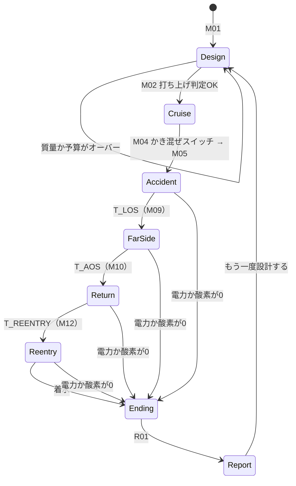

# ミッション・リターン 実装仕様 v0.1

最終更新：2026-11-14　／　読む人：iizuka（Unity実装）　／　書いた人：Taiga　／　更新：iizuka（2026-11-14、通信の決定）　／　更新：Taiga（2026-11-14、食い違い #97〜#109 の決定）

## 0. この文書の読み方

- **ロジックはこの文書、数値はJSON**です。コードに数値を直接書かないでください。Day 2 のバランス調整を、コードを触らずにできるようにするためです。
- 迷ったら `reference_sim.py` を正とします。この文書の疑似コードと同じ内容を、動く Python で書いたものです。10章のテストが通れば、設計どおりに動いています。
- 通信の作り（サーバー・クライアントの分担）は `architecture.md` に書いてあります。
- 画面に出る文字列（ヒューストンの台詞、部品名）は、提出に合わせて英語のまま JSON に入れてあります。
- 「提案」と書いた箇所は、Taiga が仮に決めたものです。実装しにくければ変えてかまいません（12章にまとめています）。

| ファイル | 中身 | 元データ |
|---|---|---|
| `SPEC.md` | この文書 | — |
| `parameters.json` | 数値パラメータ 77個（`key` / `value` / `unit` / シートの行番号） | シート「Parameters」 |
| `parts.json` | 部品カタログ、予算と質量の上限 | シート「Parts」 |
| `houston_lines.json` | マイルストーンの台詞 16本（M01〜M12、ED-A・ED-B・ED-C、R01）、状況に反応する台詞 28本 | シート「Milestones」「Houston lines」 |
| `reference_sim.py` | 1秒刻みの参照実装とテストシナリオ | — |

スプレッドシート：https://claude.ai/artifact/KC1NkXEhPLpqKMN8kNpFt9 （共有設定は Taiga 側で行います）

## 1. 何を作るか

アポロ13号型の緊急帰還ゲームです。1〜4人で遊び、1プレイは約10〜12分です（ルート A で約10分、ルート B で約11.5分）。

| 固定されているもの | プレイヤーが自由に決めるもの |
|---|---|
| ミッション目的（月の裏側を観測して帰る） | 設計：部品を上限内で好きな数だけ積む |
| 事故の内容（酸素タンクの漏れ） | 軌道とロケットの選択 |
| マイルストーン12個の順序と時刻 | マイルストーンの間のすべての操作（いつ・何を・誰が） |
| エンディングの判定式 | 帰還ルート（点火まで変更可） |

以前の「イベントを順番に出して選ばせる」方式はやめました。**リソースが毎秒減り続けるループ**が1つあり、プレイヤーはスイッチと姿勢でそれに介入します。分岐のツリーは作りません。

## 2. 全体の流れ



## 3. 状態変数

サーバーが1つだけ持ち、全クライアントに配ります。

| 変数 | 型 | 事故直後の値 | 範囲・補足 |
|---|---|---|---|
| `capacity` | float | `power_per_battery` × バッテリー数 | 固定 |
| `power` | float | `capacity` − `power_accident_loss` | 0 以下で ED-C。`capacity` を超えない |
| `oxygen` | float | `oxygen_start` + `oxygen_per_spare_tank` × 予備タンク数 | 0 以下で ED-C |
| `fuel` | float | `fuel_start` + `fuel_per_extra_tank` × 追加タンク数 | 不足すると噴射できない |
| `temp` | float | `temp_start` | 上限は `temp_start` |
| `co2` | float | `co2_start` | 0〜100 |
| `filters` | int | `co2_filters` | 残りの交換回数 |
| `leak_open` | bool | true | 正しいバルブを閉じると false |
| `leaked` | float | 0 | 漏れた累計。`oxygen_leak_max` で止まる |
| `sw[heater, lights, nav, comms]` | bool | すべて true | |
| `sw[camera, spectrometer, radar]` | bool | すべて false | 設計で積んだものだけ操作できる |
| `attitude` | enum | `earth` | `earth` / `moon` / `sun` / `burn` / `heatshield` |
| `transmit` | bool | false | |
| `observed_s[機器]` | int | 0 | 観測できた秒数 |
| `data_collected`, `data_sent` | float | 0 | 機器を区別しない1つのプール |
| `correction_done` | bool | 自由帰還軌道なら true | 観測向き軌道なら false から始まる |
| `route` | `a` / `b` / null | null | 点火まで変更可 |
| `burn_done`, `first_try` | bool | false, null | |
| `strict` | bool | false | 噴射窓を逃した／再突入の準備不足で true |
| `swaps` | int | 0 | フィルター交換の回数 |
| `t` | int | 0 | 事故からの秒 |

## 4. タイムライン

`t` は事故（M05）からの秒です。事故より前（M01〜M04）はリソースを消費しません。

| t（秒） | 名前 | できごと |
|---|---|---|
| 事故前 | — | M01 設計 → M02 打ち上げ判定 → M03 自由に操作を試す → M04 かき混ぜスイッチ |
| 0 | — | M05 事故。ループ開始 |
| 20 | `m06_delay_s` | M06 の台詞。続けて M07（観測向き軌道のみ）、M08 |
| 120 | `T_LOS` | M09。通信途絶、観測の窓が開く（180秒） |
| 300 | `T_AOS` | M10。通信回復、データを送れる |
| 330 | `T_BURN_OPEN` | M11。噴射窓が開く（60秒） |
| 390 | `T_BURN_CLOSE` | 噴射窓が閉じる |
| 420 / 510 | `T_REENTRY` | M12。再突入開始（ルートA / ルートB） |
| +20 | `reentry_ready_s` | 再突入の準備チェック |
| 480 / 570 | — | 着水、エンディング判定 |

すべてパラメータから計算します（`T_LOS = time_p2_accident_min × 60` など。`reference_sim.py` の `Sim.__init__` を参照）。M09 の台詞は、通信が切れる前に聞こえるよう `T_LOS` の10秒前に流してください（提案）。

## 5. 毎秒の更新

`dt = 1/60`（レートがすべて「毎分」なので、1秒を分で表す）。`mult` は難易度の倍率です。

```text
tick():
  # 1) 酸素漏れ
  if leak_open and leaked < oxygen_leak_max:
      x = min(oxygen_leak_per_s, oxygen_leak_max - leaked)
      oxygen -= x;  leaked += x

  # 2) 電力
  load = power_life_support + （ON になっている sw の power_* の合計）
  power -= mult * load * dt
  gen = ソーラーパネル数 * (attitude == sun ? solar_sun : solar_other)
  power = min(capacity, power + gen * dt)

  # 3) 温度
  if sw[heater]: temp = min(temp_start, temp + temp_rise * dt)
  else:          temp -= temp_drop * dt

  # 4) CO2
  co2 = min(100, co2 + co2_rise * dt)
  co2_high = (co2 >= co2_slow)

  # 5) 呼吸
  oxygen -= mult * (oxygen_breathing + (co2_high ? oxygen_co2_extra : 0)) * dt

  # 6) 観測：裏側の窓の中 + 月向き + スイッチON
  if T_LOS <= t < T_AOS and attitude == moon:
      for 機器 in ON の観測機器:
          observed_s[機器] += 1
          data_collected += data_機器 * dt

  # 7) 送信：通信できる時間帯 + 通信ON + 地球向き + 送信ON
  if transmit and has_signal and sw[comms] and attitude == earth:
      rate = 高利得アンテナあり ? tx_high_gain : tx_standard
      data_sent += min(rate * dt, data_collected - data_sent)

  t += 1

  # 8) 失敗
  if power <= 0 or oxygen <= 0: ending = ED-C
```

補足：
- `has_signal` は `t < T_LOS` または `T_AOS <= t < T_REENTRY` のとき真です。
- 観測機器は、スイッチが ON なら向きに関係なく電力を使います。向きを間違えると、電力だけ減ってデータは増えません。
- 難易度の倍率がかかるのは、電力の消費と呼吸だけです。漏れ・燃料・発電にはかけません。
- 1秒より細かく回す場合（例：0.1秒）は、`dt` と漏れの量を同じ比率で小さくしてください。

## 6. 操作（コマンド）

クライアントはコマンドを送るだけで、判定はサーバーが行います。ここに書くのはゲームのルールです。メッセージの形（JSON のキー、部屋・席取り・設計の ±・`launch`・`again`、サーバーが配る状態の中身）は `server/README.md` を正とします。

| コマンド | 席 | 使える条件 | 効果 |
|---|---|---|---|
| `stir()` | Life Support | M04 の間だけ | 押しボタンを1回押す。M05（事故）に進む |
| `set_attitude(mode)` | Pilot | いつでも | 向きが変わるたびに `fuel -= fuel_attitude_change` |
| `correction_burn()` | Pilot | 観測向き軌道で未実施、`sw[nav]` が ON | 1回押せば成立（長押しでのゲージ合わせはしない）。`fuel -= fuel_correction_burn`。`t >= T_LOS` なら `fuel_burn_retry` も引く |
| `ignite()` | Pilot と Comms & Power の同時押し | 噴射窓の中、`sw[nav]` ON、`attitude == burn`、`correction_done`、燃料が足りる | 成功：`fuel -= fuel_burn_a または b`。同時押し失敗：`fuel -= fuel_burn_retry`、やり直し |
| `close_valve(tank)` | Life Support | いつでも | `tank` は 1 か 2 をプレイヤーが選ぶ。漏れているタンク（Tank 2 固定）なら `leak_open = false`。違うタンクなら何も起きない（H08 が流れる）。開け直す操作はない |
| `swap_filter()` | Life Support と誰か1人の同時押し | `filters > 0` | `co2 = co2_start`、`filters -= 1`、`swaps += 1` |
| `switch(name, on)` | Comms & Power（heater / lights / nav / comms） | いつでも | `nav` を OFF から ON にすると `power -= power_nav_restart` |
| `switch(機器, on)` | Mission Planner | 設計で積んだ機器だけ | 5章の 6) を参照 |
| `set_transmit(on)` | Comms & Power | いつでも（実際に送れる条件は5章の 7)） | — |
| `set_route(a / b)` | Mission Planner | 点火まで | 噴射量と帰還時間が変わる |

**同時押し**：2人の押下がサーバーに届いた時刻の差が `press_window_s` 以内なら成立です。通信の遅延で厳しすぎる場合は、この値を大きくして調整します。

**操作が遅くなる**（提案）：`slow = max(寒さによる遅延, CO2による遅延)` とし、ボタンの長押し時間を「基本0.5秒 ×（1 + slow/100）」にします。寒さは `temp < temp_slow` で `slow_cold_pct`、`temp < temp_slower` で `slow_colder_pct`。CO2は `co2 >= co2_slow` で `slow_co2_pct`。

**どのタンクが漏れているか**は、タンクごとの圧力計で見分けます。状態にタンク別の圧力は足しません。漏れは Tank 2 固定なので、クライアントが `leak_open` と `leaked` から Tank 2 の針だけを下げて見せます。

**照明 OFF** は画面を暗くし、船室の天井灯（`Lamp_Cabin`）も消します。ゲームの計算には影響しません。**通信 OFF** はヒューストンの声とデータ送信が止まります。

**ヒューストンの「声」** は字幕（吹き出し）だけです。音声は付けません。

**本物との違い**：ゲームでは正しいバルブを閉じれば漏れが止まります。アポロ13号では弁を閉じても止まりませんでした。ゲームはこのままにし、事後レポートで本物との違いを見せます。

**人数と席**：4人なら1人1席。3人なら Comms & Power が Mission Planner を兼ねます。2人なら「Pilot + Mission Planner」と「Life Support + Comms & Power」（提案）。1人なら全席を切り替えます。

## 7. マイルストーンごとの判定

台詞は `houston_lines.json` の `milestone_lines` を ID で引きます。

| ID | 進む条件 | 補足 |
|---|---|---|
| M01 | — | 設計画面。質量・コスト・電力・酸素・燃料の合計を常に表示 |
| M02 | 「Ready for launch」を押す | 質量 > ロケットの上限 → 質量オーバー。そうでなくコスト > 予算 → 予算オーバー。どちらも設計画面に戻す |
| M03 | 各席が操作を1回ずつ使う、または90秒経過 | 練習。リソースは減らさない |
| M04 | Life Support がかき混ぜスイッチを押す | 20秒押されなければ台詞を繰り返す |
| M05 | — | ここで3章の初期値を入れてループ開始。警報、画面の揺れ、赤ランプ |
| M06 | t = 20 | 台詞のみ |
| M07 | 観測向き軌道のみ | `correction_burn` を解禁。未実施のままでは点火できない |
| M08 | — | `set_route` を解禁 |
| M09 | t = T_LOS | 台詞なし・送信不可。パネルの警告表示は出す |
| M10 | t = T_AOS | — |
| M11 | t = T_BURN_OPEN | `ignite` を解禁。ルート未選択で点火したら、燃料が足りれば A、足りなければ B |
| M12 | t = T_REENTRY | 20秒後に `attitude == heatshield` かつ `sw[nav]` を確認。満たさなければ `strict = true` |

**噴射窓を逃した場合**（提案）：`T_BURN_CLOSE` の時点で未点火なら、ルートBで強制的に帰還させ、`strict = true` にします。燃料は `fuel_burn_b` を引きます（軌道修正も未実施なら `fuel_correction_burn + fuel_burn_retry` を追加）。それでも燃料が足りなければ ED-C です。

## 8. エンディング・要件・スコア

```text
着水時:
  margin = strict ? end_strict_margin : 0
  ED-A: oxygen >= end_oxygen_min + margin
        and power >= end_power_min + margin
        and temp >= end_temp_min
  ED-B: 上を満たさないが生還
  ED-C: 途中で power <= 0 または oxygen <= 0（その場で終了）

科学:
  survived = (ED-A または ED-B)
  share    = data_collected > 0 ? data_sent / data_collected : 0
  base     = Σ sci_機器 × observed_s[機器] / (time_p3_farside_min × 60)
  traj     = 観測向き軌道 ? sci_trajectory_mult : 1
  science  = base × traj × (share + (survived ? (1 - share) × sci_carried_home : 0))

要件:
  Req 1: survived
  Req 2: science >= req_science_min
  Req 3: 質量 <= ロケットの上限   （打ち上げ時に確認済み）
  Req 4: コスト <= 予算           （打ち上げ時に確認済み）

スコア:
    (ED-A: score_ed_a / ED-B: score_ed_b / ED-C: 0)
  + science × score_per_science
  + (survived ? max(0,power) + max(0,oxygen) + max(0,fuel) : 0) × score_per_resource
  + (min(swaps, co2_filters) + (first_try ? 1 : 0)) × score_teamwork
  + max(0, 予算 - コスト) × score_per_budget
  + (4つの要件をすべて満たす ? score_all_requirements : 0)
```

事後レポート（R01）には、要件4つの合否、スコアの内訳、リソースの時間推移と主な操作の時刻を出します。そのために、毎秒の状態とコマンドの履歴を記録しておいてください。

## 9. ヒューストンの台詞（状況に反応するもの）

`houston_lines.json` の `reactive_lines`（H01〜H28）です。`when` は人が読むための条件で、パースする想定ではありません。ID ごとに条件をコードで書いてください。

- 一度に流すのは1本。優先度の高い順（critical > high > medium > low）。
- 閾値の台詞は、閾値をまたいだ瞬間に1回だけ出します。
- 同じ台詞は `houston_cooldown_s` 秒は繰り返しません。例外は漏れの警告（H07）で、`houston_leak_repeat_s` 秒ごとに繰り返します。
- 通信途絶中（`T_LOS`〜`T_AOS`）は、声なしでパネルの警告表示だけにします。
- `sw[comms]` が OFF の間は、台詞を出しません。ON に戻したら H27 を流し、続けてその時点で最も優先度の高い警告を流します。

## 10. テストケース

`python3 reference_sim.py` で再現できます。操作の時刻は同ファイルの `PLAY_GOOD` を見てください。サーバー（Python）は reference_sim の計算をそのまま使う。Unity は計算しない（`architecture.md`）。

| # | 設計 | 操作 | 結末 | 電力 | 酸素 | 燃料 | 温度 | 科学 | スコア |
|---|---|---|---|---|---|---|---|---|---|
| T1 | バッテリー3、カメラ+分光計、観測向き軌道、大型 | 良い操作（ルートA） | ED-A | 51.1 | 32.0 | 30 | 13.6 | 3.375 | 1260.6 |
| T2 | バッテリー2、カメラ、自由帰還、小型 | T1と同じ操作 | ED-B | 13.1 | 32.0 | 45 | 13.6 | 1.0 | 690.1 |
| T3 | T1の設計を小型ロケットで | — | 質量オーバー（質量111 > 100） | — | — | — | — | — | 0 |
| T4 | T2と同じ | バルブを閉じるだけ | ED-C（t=400 で電力0） | 0 | 38.3 | 75 | 22 | 0 | 100 |
| T5 | T1と同じ | バルブ25秒、ルートB、点火を1回失敗 | ED-B | 39.1 | 3.0 | 45 | 11.4 | 3.375 | 984.6 |

T1 は要件4つすべて合格、T2 は Req 2（科学）が不合格です。T2 が ED-B になるのは、電力 13.1 が基準の 15 を下回るためです。

シート「Balance」は同じ式の概算版です。T1 の設計を入れるとスコア 1261.1（電力 52.6、燃料 29）になり、参照実装の 1260.6 とほぼ一致します。差は、Balance が「航法をずっと OFF」「姿勢変更6回」と仮定しているためです。

## 11. 優先度

**必須（これがないとゲームにならない）**
- [ ] 設計画面：部品の ± と合計表示、打ち上げ判定（M01〜M02）
- [ ] 毎秒のループ（5章）と状態の同期
- [ ] 操作：バルブ、スイッチ4つ、観測機器、姿勢、送信、ルート選択、点火（6章）
- [ ] タイムライン：通信途絶、観測の窓、噴射窓、再突入（4章）
- [ ] エンディング3種と事後レポートの要件4つ・スコア（8章）
- [ ] マイルストーンの台詞（M01〜M12、エンディング）
- [ ] 帰還ルート2本の軌道表示（GMAT）

**余裕があれば**
- [ ] 状況に反応する台詞（H01〜H28）。まず critical と high だけでも可
- [ ] CO2とフィルター交換、寒さ・CO2による操作の遅延
- [ ] ソーラーパネルと太陽向き、追加の燃料タンク、レーダー
- [ ] 軌道修正の噴射（M07）。省く場合は観測向き軌道も外す
- [ ] 事後レポートのリソース推移グラフ
- [ ] 要件トラッカー（Req 1〜4 のいまの状況）。xlsx にある「残り何分」の計器は作りません
- [ ] 難易度レベル2・3

## 12. 未決事項・確認したいこと

1. **GMAT の軌道**：帰還ルート A / B の2本は必須です。往路（自由帰還／観測向き）の2本は、同じ1本を描いてラベルだけ変える形でも成立します。出せそうですか。
2. **同期の方式**：サーバーが状態を1つ持ち、クライアントはコマンドを送るだけ、という前提で書いています。今の通信基盤で問題ありませんか。4人まで対応できますか。**決定：サーバーが状態を持つ方式で、サーバーは Python（`architecture.md`）。**
3. **同時押しの受付幅**：`press_window_s` は 0.5秒です。WebSocket の遅延を考えると短いかもしれません。実測して決めたいです。
4. **1〜2人プレイの同時押し**：1人のときは「2つのボタンを同時に押す」でよいか（提案）。
5. **噴射窓を逃した場合**：7章の扱い（ルートBで強制帰還 + 判定を厳しく）は提案です。
6. **間違ったバルブを閉じた場合**：追加のペナルティはなしにしています。漏れが続くこと自体が損失になるためです。
7. **姿勢変更にかかる時間**：今は即時です。数秒かけて回す演出を入れるかは任せます。
8. **シートに追記した数値**：`parameters.json` の行 70〜78 は、この仕様のために新しく足したものです（噴射窓の開始、遅延の割合、判定を厳しくする幅など）。値は仮です。
