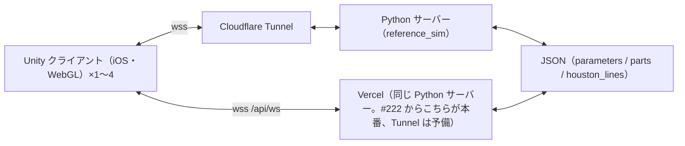

書いた人：iizuka ／ 最終更新：2026-11-15（#222 ブラウザ版の置き場所） ／ 更新：Taiga（2026-11-15、#222）

# 通信とサーバーの作り

## 構成図



## 決めたこと

- サーバーが状態を1つ持ち、クライアントはコマンドを送るだけ（SPEC 3章・6章の前提どおり）
- サーバーは Python の WebSocket サーバー。`reference_sim.py` の計算（`Sim`、`launch_check` など）をそのまま使う
- 1秒ごとに tick して、状態を全員に配る。同時押しの判定（`press_window_s`）もサーバー
- Unity は状態を受け取って描き、ボタンを送るだけ。シミュレーションを C# に移植しない
- SPEC 10章の確認（±0.5 以内）は、サーバーの Python が reference_sim と同じ結果を出すことで行う
- 公開は自宅サーバー＋Cloudflare Tunnel（ポート開放なし。https・wss が付く。WebGL は wss が必須）
- **サーバーは Vercel に置く**（Taiga 2026-11-15、#222。上の「自宅サーバー＋Cloudflare Tunnel」は予備に回す）。同じ Python サーバーを `server/app.py`（FastAPI の WebSocket、`wss://<host>/api/ws`）から動かす。ブラウザ版（WebGL のビルド）も同じ Vercel プロジェクトに置く。手順と Vercel の決まり（部屋はメモリの中・接続は最大時間で切れる）は `tools/vercel/README.md`
- クライアントは iOS（Apple Developer Program で配る）とブラウザ。つなぐ先の決め方は `Net/WebLink.cs`
- 予備は同じプログラムをクラウド（Fly.io・Render など。料金は未確認）に置く
- Unity の WebSocket は、エディタ・iOS・デスクトップが C# 標準の `ClientWebSocket`、WebGL がブラウザの WebSocket（`Plugins/WebGL/MrWebSocket.jslib`。ライブラリは入れない）。どちらも `Net/WsClient.cs`（#222）
- プレイヤー同士の声はつながない（ボイスチャットなし。同じ場所で話す前提、離れているなら通話アプリ）。コミュニケーションの機能は作らない（#155・#159）
- 担当：iizuka がサーバーと Unity、Taiga が物語・台詞・パラメータ・UI など上の層。UI は、Taiga が絵とレイアウト（何をどこにどう見せるか）まで、Unity への組み込みは iizuka（#110 の決定。更新：Taiga 2026-11-14）

## メッセージの形（案）

クライアント → サーバー（コマンド名は SPEC 6章に合わせる）：

```json
{"cmd":"switch","name":"heater","on":false,"seat":"comms_power"}
```

サーバー → クライアント：

- 毎秒の状態のスナップショット：`{"type":"state","t":120,"state":{...}}`（SPEC 3章の状態変数）
- 台詞・イベント：`{"type":"event","kind":"houston","id":"...","text":"..."}`

## 採らなかったもの

- ポート開放：手間がかかり、安全面も不安
- Photon：ロジックを C# で書き直す必要がある
- P2P／WebRTC：つなぎ役と中継のサーバーが結局要る。会場の Wi-Fi で不安定。WebGL の対応が弱い

## 未決定

- 部屋の作り方（合言葉で入る形にするか）
- 再接続：**決定（#94）**。切れた人は自動で同じ部屋・同じ席に戻る（サーバーは `player_id` で戻せる。`server/README.md`）。ほかの人が席を引き継ぐ仕組みは作らない。画面の表示は #94
- 遅延の実測と `press_window_s`（0.5秒で足りるか）

## 軌道の表示（Issue #65）

- データの流れ：GMAT（`data/gmat/return_routes.script`）→ `data/gmat/route_a.csv`・`route_b.csv`（正）→ Unity のメニュー `Tools/GMAT/軌道を取り込む` → `unity/Assets/Data/Gmat/Route_A.asset`・`Route_B.asset`（`GmatRoute`）。
- ゲームの `t`（事故からの秒）と GMAT の時間の対応は `data/gmat/time_map.json`（区切りごとに線形。中身と根拠は `data/README.md`）。サーバーも同じファイルを読めば、`t_los`・`t_aos`・再突入を軌道と合わせられる。
- 描画は `unity/Assets/Scripts/Visual/TrajectoryView.cs`。入力は `t` と `route`（a/b/空）。確認用シーンは `OrbitMap.unity`、画像は `docs/design/lookdev/orbit_map.png`。地球・月は太らせ、近くの線は球の外へ押し出している。
