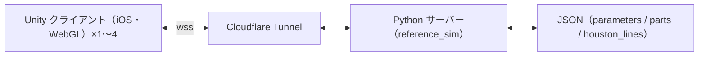

書いた人：iizuka ／ 最終更新：2026-11-14

# 通信とサーバーの作り

## 構成図



## 決めたこと

- サーバーが状態を1つ持ち、クライアントはコマンドを送るだけ（SPEC 3章・6章の前提どおり）
- サーバーは Python の WebSocket サーバー。`reference_sim.py` の計算（`Sim`、`launch_check` など）をそのまま使う
- 1秒ごとに tick して、状態を全員に配る。同時押しの判定（`press_window_s`）もサーバー
- Unity は状態を受け取って描き、ボタンを送るだけ。シミュレーションを C# に移植しない
- SPEC 10章の確認（±0.5 以内）は、サーバーの Python が reference_sim と同じ結果を出すことで行う
- 公開は自宅サーバー＋Cloudflare Tunnel（ポート開放なし。https・wss が付く。WebGL は wss が必須）
- 予備は同じプログラムをクラウド（Fly.io・Render など。料金は未確認）に置く
- Unity の WebSocket は、WebGL と iOS の両方で動くライブラリ（NativeWebSocket など。ライセンスは入れる前に確認）。WebGL は C# 標準の WebSocket が使えないため
- 担当：iizuka がサーバーと Unity、Taiga が物語・台詞・パラメータ・UI など上の層

## メッセージの形（案）

クライアント → サーバー（コマンド名は SPEC 6章に合わせる）：

```json
{"cmd":"switch","name":"heater","on":false,"seat":"comms_power"}
```

サーバー → クライアント：

- 毎秒の状態のスナップショット：`{"type":"state","t":120,"state":{...}}`（SPEC 3章の状態変数）
- 台詞・イベント：`{"type":"event","kind":"houston","id":"...","text":"..."}`

## 採らなかったもの

- ポート開放：手間がかかり、安全面も不安
- Photon：ロジックを C# で書き直す必要がある
- P2P／WebRTC：つなぎ役と中継のサーバーが結局要る。会場の Wi-Fi で不安定。WebGL の対応が弱い

## 未決定

- 部屋の作り方（合言葉で入る形にするか）
- 再接続（切れた席に戻す方法）
- 遅延の実測と `press_window_s`（0.5秒で足りるか）
