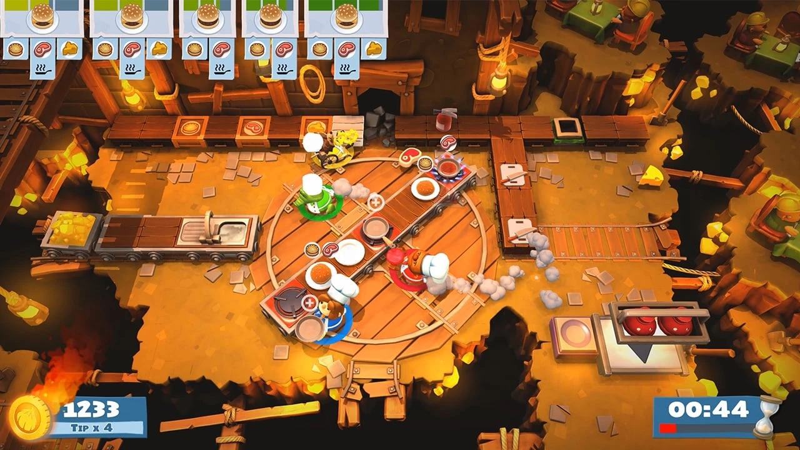

書いた人：iizuka ／ 最終更新：2026-11-14

# 見た目の方向性

## 決めたこと

**Overcooked のような雰囲気にする。** 狙いは、宇宙を知らない高校生に「やってみたい」と思わせて広めること（バズ）と、見た目で障壁を下げること。

| 参考 | |
|---|---|
|  |  |

真似するのは次の**方向性だけ**：

- 丸くて頭身の低いデフォルメのキャラ
- 明るく暖かい色
- 斜め上から見下ろすカメラで、全員と船内が一度に見える
- ゴツくて一目で分かるオブジェクト（スイッチ・バルブ・レバー）
- 協力プレイの賑やかさ（煙、揺れ、アイコンの吹き出し）

**Overcooked のキャラ・アート・UI そのものはコピーしない。** 参考画像は雰囲気を共有するためだけのもので、ゲームには入れない。

科学的な正しさは、見た目ではなく軌道（GMAT）とパラメータで担保する（議事録 2.1）。

## 作り方の計画

Fable 5.2 のアドバイス（2026-11-14）をもとにした案。Taiga と確認して確定する。

### 方針：Blender で作る 7割、無料モデル 2割、改造 1割

- **Blender で作る**：船内・操作部品・クルー。統一感は「同じパレット・同じベベル」で出すのが一番安い。箱・円柱・球の組み合わせは Blender MCP の得意分野
- **無料モデル**：背景の小物と、クルーがうまくいかなかったときの保険だけ。探すのは **45分で打ち切る**（画風の違うパックを混ぜると崩れる）
- **改造**：宇宙船の外観と地球・月だけ。NASA のメッシュは重く、削っても丸くならないので、**シルエットの下敷きにして作り直す**。地球・月は NASA の画像を色数を落として貼る

議事録 3.1 は「NASA の無料モデルを優先」だが、この案では NASA モデルは下敷きと出典に使う（見た目を揃えるため）。

### アセット一覧

| アセット | 作り方 | 優先度 | 目安 |
|---|---|---|---|
| 船室（屋根なしの断面、円形の床、壁、窓1つ） | 作る | 必須 | 40分 |
| コンソール台（1種を色と天板違いで4席分） | 作る | 必須 | 40分 |
| 操作部品：スイッチ、バルブ、点火ボタン、姿勢スティック、ルート切替レバー、送信ボタン（可動部は別オブジェクト） | 作る | 必須 | 60分 |
| クルー1体（ヘルメット＋豆型の胴＋短い手足、2〜2.5頭身、色違いで4人） | 作る（保険で無料モデル） | 必須 | 60分 |
| 地球・月（球＋NASA 画像） | 改造 | 必須 | 30分 |
| 宇宙船の外観（司令船・機械船＋月着陸船） | 改造（下敷きにして作り直す） | 必須 | 60分 |
| ゲージ、警告灯、軌道線、ヒューストン先生の顔 | Unity の UI・2D | 必須 | — |
| 酸素漏れのガス、警告灯の点滅 | Unity のパーティクル・発光 | 必須 | iizuka |
| 設計画面の部品アイコン | 作ったモデルを画像に書き出す | 機体設計を作るなら必須（#9） | 30分 |
| CO2 フィルター（四角い缶とダクトテープ。アポロ13号の名場面） | 作る | 余裕があれば | 20分 |
| 浮いている小物（ペン、食料パック、手順書） | 無料モデル | 余裕があれば | — |
| Saturn V（打ち上げ演出） | 改造 | 余裕があれば | 40分 |
| 管制室、地上アンテナ | 作らない（2D の通信ウィンドウで代用） | 見送り | — |

### 統一感のルール

- **塗り**：トゥーンもアウトラインも使わない。URP 標準の Lit（Smoothness 0・Metallic 0）。輪郭線は「今押せる部品」のハイライトだけ
- **色**：全モデルが 1枚のパレット画像（16色）と 1つのマテリアルを共有する
  - 船内：クリーム `#F2E3C6`、オレンジ `#F28C28`、青緑 `#2A9D8F`、濃紺 `#1D2D50`
  - 席の色：赤 `#E4572E`、青 `#3A86FF`、黄 `#FFC857`、緑 `#6BBF59`（色だけに頼らず席アイコンも付ける）
  - 状態の色（緑・黄・赤）はランプと UI 専用。モデルの塗りには使わない
  - 外の宇宙は濃紺。船内の暖色との対比で締める
- **光**：暖色の平行光 1灯（`#FFE2B8`、ソフトシャドウ）＋環境光。ポストはブルーム弱め・ビネット・彩度 +10。影は Blender で頂点カラーに焼く
- **形**：全部の角にベベル（2〜4cm、2段）。細い部品は作らない。スイッチ類は実物の約3倍に誇張する
- **ポリゴン数**：小物 300〜1,500 三角、クルー 3,000 以下、船室 10,000 以下、画面全体 150,000 以下
- **スケール**：1 unit = 1m。クルー 1.2m、コンソール天板 0.8m、床の直径 6m。原点は床の中心、可動部の原点は回転軸
- **カメラ**：固定の透視、FOV 30°、見下ろし 50°。4席が1画面に入る。クルーは席に固定で、無重力でゆっくり上下に揺れるだけ

### 無料素材の探し先（ライセンスは使う前に各ページで確認）

| 探し先 | ライセンス | 向いているもの |
|---|---|---|
| Quaternius | CC0 | 宇宙飛行士・惑星・小物。画風が一番近い |
| KayKit | CC0 | 宇宙基地の小物、キャラ |
| Kenney | CC0 | 宇宙キット、UI、効果音 |
| Poly Pizza | モデルごとに CC0 か CC-BY | 小物の単品 |
| Sketchfab | 多くが CC-BY（表記必須）。NC・ND は使わない | 最後の手段 |
| NASA 3D Resources、Blue Marble、LRO の月の画像 | 原則著作権なし。NASA のロゴ・記章は使わない | 下敷き、地球・月 |

使った素材は全部 `CREDITS.md` に「名前・作者・URL・ライセンス」を書く。提出物にも載せる。

### Unity への取り込み

- 全アセットを Blender に通して `.glb` で書き出し、Unity は glTFast で取り込む
- 取り込んだマテリアルは使わず、共通の URP Lit マテリアル 1つに差し替える（WebGL でピンクになる事故を避ける）
- NASA の `.glb` は Unity に直接入れない。Blender で下敷きにするだけ
- WebGL：テクスチャはパレット 256px と地球・月の 1024px だけ。圧縮は Brotli。初回ダウンロード 30MB 以下が目標
- Blender から書き出すときは +Y Up・Apply Transform・スケール 1.0。書き出しスクリプトを 1本作って手作業のミスをなくす

### 最初の2時間

ゴール：Unity の画面で「船室の中に、クルー1人がコンソール1台の前にいる」スクリーンショットが1枚ある。

| 時間 | Taiga | Claude（Blender MCP） |
|---|---|---|
| 0:00〜0:20 | 上のルールを確定。#9 の食い違いを iizuka と決める | Blender の土台：単位、パレット、1.2m のダミー、Unity と同じカメラ、書き出しスクリプト |
| 0:20〜0:50 | 無料素材を探す（30分で打ち切り） | コンソール1台、スイッチ、バルブ |
| 0:50〜1:20 | 形と色を見て直しを指示 | クルー1体（色違い4人分） |
| 1:20〜1:50 | iizuka と Unity に置き、光・カメラを合わせる。WebGL の容量を見る | 直しの反映、船室の床と壁 |
| 1:50〜2:00 | クルーを自作で行くか無料素材にするか決める。残りを Issue にする | 残りの作る順番を出す |

2時間で絵が決まらなければ、クルーだけ Quaternius の宇宙飛行士に切り替える。

### デフォルメにするリスクと打ち消し方

| リスク | 打ち消し方 |
|---|---|
| おもちゃっぽく、科学的に軽く見える | 軌道は GMAT の出力そのまま。提出資料の1枚目に「見た目はデフォルメ、数字と軌道は本物」と書く |
| 数値の根拠が見えない | `parameters.json` の値に出典を付け、事後レポートに「実際のアポロ13号では」を1行ずつ出す |
| NASA のリソースを使っていないように見える | GMAT、地球・月の画像、NASA モデルを下敷きにした外観を「使った NASA データ」として一覧にする。部品名は実名（CSM、LM、LiOH 缶） |
| 宇宙船が何かわからない | 色と比率は崩しても、円錐＋円筒＋ノズルのシルエットは実物に合わせる |
| Overcooked に似すぎる | コック帽、腕がなく手だけ浮く体型、注文札風の UI は使わない。無重力で浮くクルーと宇宙服で別物にする |
