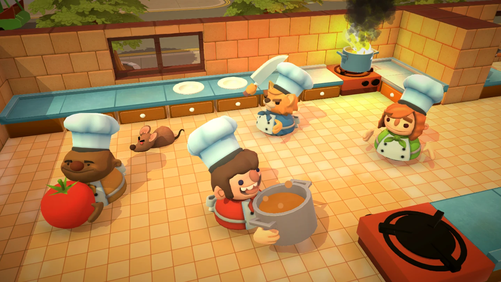

書いた人：iizuka ／ 最終更新：2026-11-14

# 見た目の方向性

## 方向性

**Overcooked のような雰囲気にする。** 狙いは、宇宙を知らない高校生に「やってみたい」と思わせて広めること（バズ）と、見た目で障壁を下げること。

| 参考 | |
|---|---|
|  |  |

真似するのは**方向性だけ**：丸くて頭身の低いデフォルメ／明るく暖かい色／斜め上から全員と船内が見えるカメラ／ゴツくて一目で分かる操作部品／協力プレイの賑やかさ（煙、揺れ、アイコンの吹き出し）。

**Overcooked のキャラ・アート・UI そのものはコピーしない。** 参考画像は雰囲気の共有用で、ゲームには入れない。コック帽、腕がなく手だけ浮く体型、注文札風の UI は使わない。

科学的な正しさは、見た目ではなく軌道（GMAT）とパラメータで担保する（議事録 2.1）。

## 決めたこと

| 項目 | 決定 |
|---|---|
| 作り方 | Blender で作る（CLI のみ）。宇宙船と地球・月は NASA の資料を下敷きにする |
| 書き出し | FBX が正（glb も出す）。glTFast は使わない |
| マテリアル | 全モデル共通の `M_Core_Palette` 1つ（取り込み時に自動で差し替える。#38 で済み）。地球・月だけ自分の画像 |
| パレット | 16色。船内 `cream` #F2E3C6／`orange` #F28C28／`teal` #2A9D8F／`navy` #1D2D50、無彩色 4色、`visor` #0E1630。色名と色コードは `modeling/core/palette.json` が正 |
| 席の色とアイコン | Pilot 赤 `#E4572E` ▲／Life Support 緑 `#6BBF59` ●／Comms & Power 黄 `#FFC857` ■／Mission Planner 青 `#3A86FF` ◆（色だけに頼らずアイコンも付ける） |
| ランプの色 | `lamp_green`・`lamp_yellow`・`lamp_red` は `Lamp_` の部品だけ。モデルの塗りには使わない。発光は Unity で付ける（`LampGlow` が `.Lamp_` の部品を発光マテリアルに差し替えて点滅させる。#55） |
| 塗り | トゥーン・アウトラインなし。輪郭線は「今押せる部品」のハイライトだけ |
| 形 | 全部の角にベベル（2〜4cm、2段）。細い部品は作らない。スイッチ類は実物の約3倍に誇張する |
| スケール | 1 unit = 1m。クルー 1.2m、コンソール天板 0.8m |
| 宇宙船 | NASA モデルを下敷きに作り直した。実寸、原点はノズル出口、長軸 +Z。旗・文字・記章なし |
| 船室 | 手前の壁と天井を外せる「ドールハウス型」（#40）。カメラが断面でも俯瞰でも使える。Unity に置いてある（ルートを Y まわり 180° に回して置く。席・クルー・タンクは Slot の子に置く） |
| 船室の床 | 明るいクリーム色（`cream`）に、同心円の灰色の目地（`gray_light`）。中央に青緑の輪（部屋の中心の目印） |
| 作っていないもの | 設計画面の部品アイコン（#9 で必要になった）、管制室、Saturn V、月の顔 |
| 無重力（#64） | クルーが浮く（`CrewFloat`）、小物が漂う（`FloatProp`：ペン・手順書・宇宙食・ダクトテープが数 cm〜十数 cm 揺れながら毎秒 5〜15° 回る）、漏れたガスは上に昇らず四方にゆっくり広がる（重力 0、広い Cone、減速、だんだん大きく薄く） |
| #9 の決定 | 機体設計あり、スコアあり、標準 3人（1〜4人）、クルーは席に固定、iOS も作る |

## 光と後処理（Unity）

影を頂点カラーに焼くのはやめた。**光と後処理は Unity で付ける**。のっぺり見えるのは光のせい。値は #55 で決めた（2回目。船室 #40 が入ったあとの値）。

見た目：`docs/design/lookdev/`（俯瞰 `lookdev_top.png`・断面 `lookdev_side.png`・寄り `lookdev_close.png`、1600×900、WebGL・iOS と同じ品質 Mobile で撮影）。
値は全部 `unity/Assets/Editor/LookDev/LookDevSettings.cs` の定数にある。変えたらメニュー **Tools/LookDev/シーンを作り直す** → **Tools/LookDev/スクリーンショット** で撮り直し、この表も直す。

**URP**（PC と Mobile の両方の品質で同じ値。WebGL・iOS は Mobile を使う）

| 項目 | 値 |
|---|---|
| 描画 | Forward（PC の Renderer は Forward+ だったのを直した。Forward+ は WebGL で不具合報告あり） |
| HDR | オン（ランプの Bloom に要る） |
| MSAA | 2x |
| 主光源の影 | 解像度 1024、カスケード 1、距離 15m、Soft Shadows（Medium）、Depth Bias 0.6・Normal Bias 0.6 |
| 追加ライトの影 | なし |
| SSAO（Renderer Feature） | 両方の Renderer に入れる。Downsample オン、Samples Medium、Blur High、Radius 0.25、Intensity 0.4、Direct Lighting 0.25、Source Depth Normals（Samples Low はざらつきが目立った） |
| 描画の縮小（Render Scale） | PC 1.0、Mobile 0.8（元のまま） |

**シーンの光**（`LookDevSettings.ApplyLighting`。メニュー Tools/LookDev/今のシーンに光を入れる で、ほかのシーンにも同じ光を入れられる）

| 項目 | 値 |
|---|---|
| 主光源 | Directional、`#FFE2B8`、強さ 1.4、回転 X 55°・Y −15°、Soft Shadows、影の強さ 0.6 |
| リム光 | Directional、`#9DB4FF`、強さ 0.4、回転 X 25°・Y 150°（主光源の反対側の上）、影なし |
| 環境光 | Gradient：Sky `#B8A898`（暖）・Equator `#8A7F86`（中間）・Ground `#5A5058`（暗め） |
| 映り込み | 空から、強さ 0.4（パレットは Smoothness 0 なのでほぼ効かない） |
| 空 | `Assets/Art/Sky/M_Sky_Space.mat`（Skybox/Panoramic、露出 1.8、回転 200°）。画像は Kenney の宇宙の空を濃紺に寄せたもの（`art/make_sky.py`、2048×1024） |
| 焼き込み | ライトマップなし。環境光と空の映り込みだけ焼く（焼かないとビルドで環境光が既定のものになる） |

**後処理**（Global Volume、`Assets/Art/LookDev/LookDev_Volume.asset`）

| 項目 | 値 |
|---|---|
| Tonemapping | Neutral |
| Bloom | 閾値 0.9、強さ 0.7、Scatter 0.6（にじむのはランプ。画面の青緑は閾値に届かない） |
| Color Adjustments | Contrast +12、Saturation +16、露出 0 |
| White Balance | Temperature +15（暖かめ） |
| Vignette | 0.12、Smoothness 0.45 |
| Motion Blur | 切る |

**光る物・煙**

| 物 | 中身 |
|---|---|
| ランプ | `M_Lamp_{Red,Yellow,Green}.mat`（URP Lit、色はパレットの `lamp_*`、Emission は強い成分ほど持ち上げて 2^2.5 倍。ハイライトなし）。`LampGlow` が警告ランプ（`.Lamp_` の部品のうち `Lamp_Cabin` 以外）に当てて 0.9 秒で点滅。警報には赤い Point Light（強さ 2.0、範囲 3.5m、影なし）を `Slot_Alarm_1`・`_2` の両方に付けて一緒に点滅 |
| 室内灯 | 屋根の内側の `Lamp_Cabin`（白）は `LampGlow` で暖色の白に光らせる。点滅せず、常に光る。部屋の明かりは `Slot_Center` の上 2.2m に置く Point Light（`#FFE2B8`、強さ 1.5、範囲 5m、影なし） |
| コンソールの画面 | `ScreenGlow` が `Console_*` の画面の部品を、青緑（teal `#2A9D8F`）×1.5 の発光マテリアルに差し替える。Bloom の閾値 0.9 には届かないので、にじまない |
| 酸素ガス | `Assets/Art/VFX/GasLeak.prefab`。破れたタンクの `.Slot_Leak` の子に置く（局所 +Y に噴く）。URP Particles/Unlit、アルファ（加算ではない）、Kenney の白い煙4枚のアトラス、毎秒 26 個・寿命 1.4〜2.2 秒・すぐ減速して広がる。粒の大きさは 1.3 倍（#55） |

## キャラ（クルー）

iizuka のスケッチに合わせて作り直した（#39 で済み）。

- 約2頭身、身長 1.2m
- 大きな丸いヘルメット、横長の角丸バイザー
- 腕と脚が胴に溶け込んだ、1つの丸いかたまり
- 目はバイザーの中に小さく残す（普通・パニック・安心の3種の表情）
- **胸に NASA の文字は入れない**（胸は席のアイコン）
- 席に固定で歩かない。無重力でゆっくり上下に揺れるだけ
- **クルーは Unity で浮かせる**（腕が天板に届く高さ）。腕（`Arm_L`・`Arm_R`、肩が原点）を X まわり −85° 回して前に出し、床から 0.28m 浮かせると手が天板 0.80m に届く。コンソールの正面から 0.58m の所に、コンソールの方を向けて置く。揺れは `CrewFloat`（上下 ±3cm・3.2 秒、向き ±4°、傾き ±2°、4人で位相をずらす。Play のときだけ動く）
- ヘルメットの上には何も付けない（頭の上の輪は天使の輪に見えるのでやめた）。席の色は首のリング・胴・腕・脚・背中の装置と床の席の印で見せる。俯瞰で席を見分けるため
- 体と腕はコンソールに向けたまま、ヘルメットだけ部屋の中心側へ振る（`CrewLook` の `normalEuler` は X −15°・Y 60°。左側の席は Y −60°）。焦ったとき・成功のときは、ヘルメットをカメラの方へ向けて表情を見せる（体は動かさない。0.2 秒でなめらかに切り替える）

## 未決定のこと

- カメラ：断面（スケッチ）か俯瞰 50° か（#9 の残り）
- ランプの発光を、取り込み時に差し替えるか、ゲームの中で状態に合わせて切り替えるか（いまは `LampGlow` でゲームの中。どちらにもできる）
- 床の中央（`Slot_Center`）に何を置くかは未決定。今は俯瞰カメラを寄せて、床の手前を画面の外へ切っている

## 詳しいルールの場所

- 制作のルール・チェック基準・決定事項：`modeling/core/README.md`
- 制作の計画・無料素材の探し先・経緯：`docs/reference/modeling-plan.md`
- 調査（落とし込みルール、似すぎの線引き）：`docs/reference/art-research.md`
- 参考画像：`docs/reference/art-ref/`
