書いた人：iizuka（調査：haiku 3体・まとめ：sonnet）／ 最終更新：2026-11-14

# 見た目の参考調査：「柔らかいモデル」の傾向（Overcooked / Fall Guys / Among Us）

宇宙を知らない高校生にバズる見た目を決めるための資料。対象は iizuka・Taiga。

> **参考画像は雰囲気の共有用。ゲームには入れない。キャラ・アートはコピーしない。**
> 一次情報は少なく、頭身・ポリゴン数・塗り・質感の数値根拠はない。真似るのは「判断の仕方」で、数値ではない。

## 1. 結論：このゲームに落とし込むルール

1. 2〜2.5頭身。ヘルメットを体の半分近くまで大きく
2. 丸いヘルメット＋ずんぐりした胴＋短い手足。ヘルメットと胴を別パーツに見せ、一色の豆型にしない
3. 顔は出す。バイザーの中に目だけの簡単な顔（驚く・焦る・ほっとする）。顔なしにしない
4. 席の色でヘルメットのリングと胴を塗り、席アイコン（形）を必ず併記。色覚で区別できる組み合わせに
5. 動きは「ゆっくり上下」が基本、危機のときだけ誇張（慌てる＝揺れが速く大きく、操作中＝腕が大きく、成功＝一瞬跳ねる）
6. 操作部品は実物の約3倍。押せる部品だけ輪郭ハイライト。無関係な小物は置かない
7. 固定の見下ろしカメラで4席と船室が一度に入る
8. 画面の操作は1席2〜3個。文字よりアイコンと色。専門用語（CSM、LiOH）は小さな補助ラベル、メインは平易な言葉
9. 危機は一度に1つだけ前面に、ほかは小さく待機表示
10. 画面を縮小して、色・形・動きで誰が何をしているか分かるか毎回確かめる

## 2. 3作の共通点

| 共通点 | 裏付け |
|---|---|
| シルエットだけで何者か分かる単純な形 | 発言あり（Fall Guys：単純で簡単にカスタマイズ）／推測（大人数でも読みやすい） |
| 明るい塗りつぶしで質感に頼らない | 発言あり（Overcooked：bright solid images）／二次情報（Fall Guys：高彩度寄り） |
| 遠くから読める | 発言あり（Overcooked：Duncan） |
| 色と形でプレイヤーを区別 | 発言あり（Among Us：色依存を減らしたい）／推測 |
| 操作・要素を絞り初見で圧倒しない | 発言あり（Overcooked：相互作用を絞った） |
| 動きを誇張して状況を読ませる | 二次情報 |
| 作る手間が小さく、配信・ファンアートでも崩れない | 二次情報（Among Us：簡素な絵柄）／推測 |

違い：
- Overcooked：世界とキャラの両方を明るく、固定カメラで全員が見える（協力に効く）
- Fall Guys：キャラの体の面白さが主役（物理の笑い・着せ替え）
- Among Us：顔なし＋バイザー＋色だけで識別（最小の絵柄で配信映え）。宇宙は舞台装置でルール中心なので宇宙知識が要らない（推測）

## 3. ゲームごとの節

### Overcooked
- 開発者 Phil Duncan は「bright solid images」（明るい塗りつぶしの面）を狙った（発言あり）
- カメラが大きく引かないようレベルを広げすぎない。遠くから読めることを重視（発言あり）
- UI は大きな制約。レシピを効率よく伝える工夫をしている（発言あり）
- 相互作用を絞り、プレイヤーが圧倒されないようにした（発言あり）
- 誇張された動きで、誰が何をしているか読める（二次情報）
- 頭身・顔・塗り・ポリゴン数は情報なし。Unity 製

| 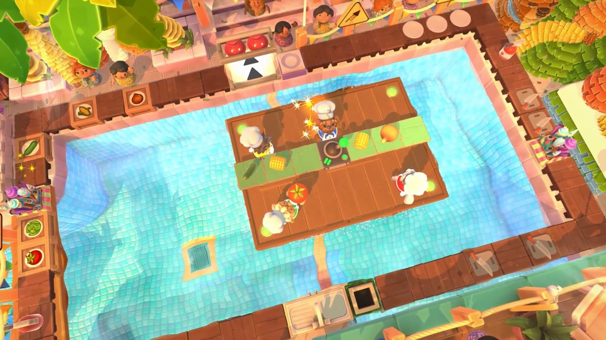 | 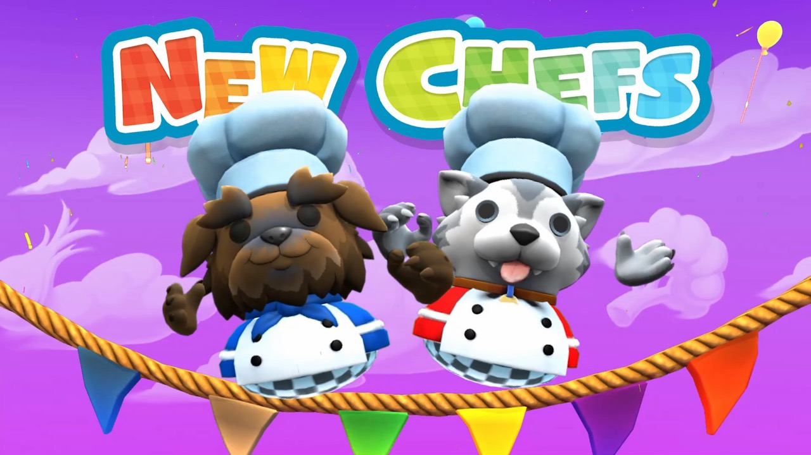 | 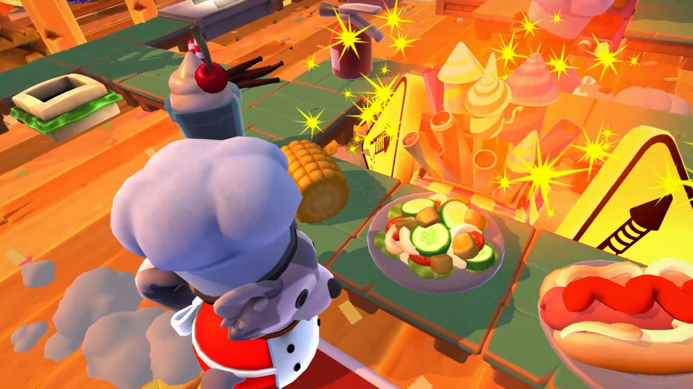 |
|---|---|---|
| 1：海上の調理台の俯瞰。コック帽のキャラ数人 | 2：犬キャラがコック帽・コック服で並ぶ | 3：肩越し視点。特大のポテトとサラダ |

| 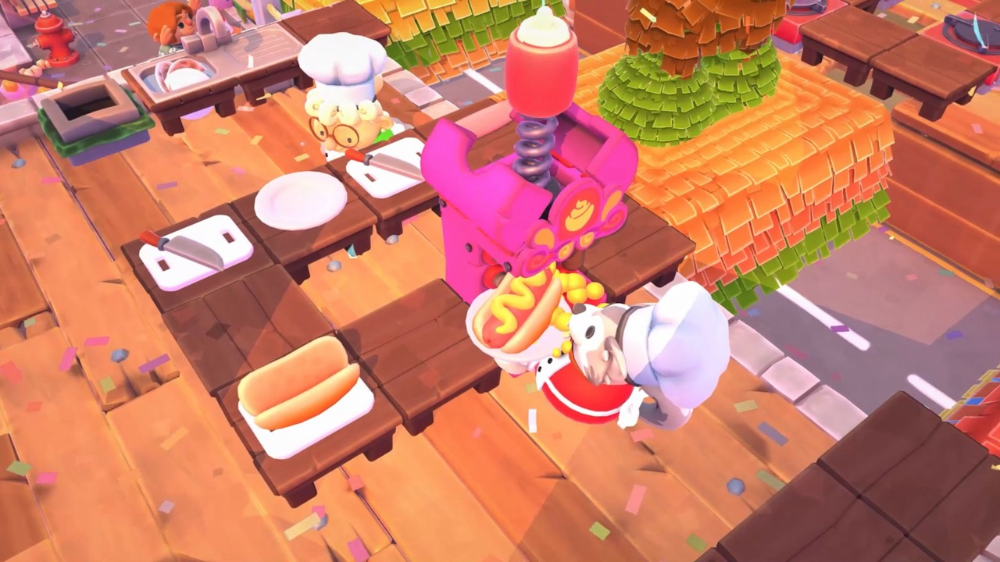 | 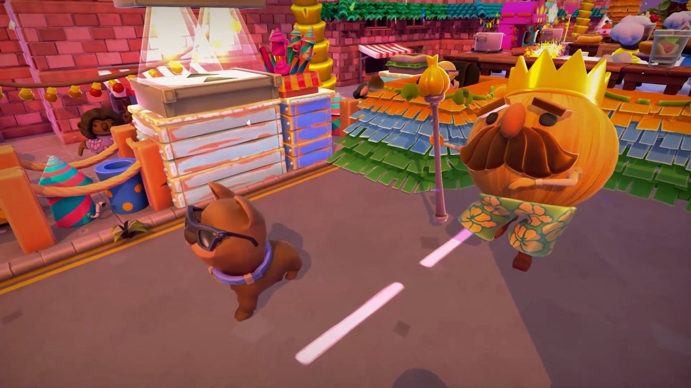 |
|---|---|
| 4：屋台風の厨房の俯瞰。ソフトクリーム機とホットドッグ | 5：サングラスの小犬と王冠のカボチャ王様 |

### Fall Guys
- 豆型で上が重い胴体。手は大きめ、足は短い、目は頭から飛び出す形（二次情報）
- 方針は「ぐにゃぐにゃで曲がるが壊れそうに見えない」「一番面白いバージョンは何か」（発言あり：Anthony Pepper）
- 初期条件は「単純で簡単にカスタマイズできる」（スキン前提）
- 色は candy-coated・高彩度寄り（レビュー）
- 単純な形は大人数でも読みやすい（分析・推測）
- 塗り・質感・ポリゴン数は不明

| 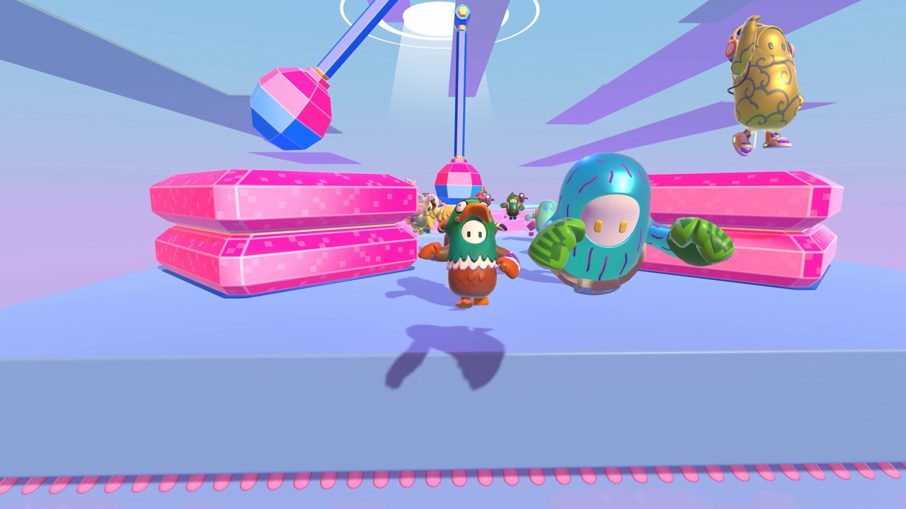 | 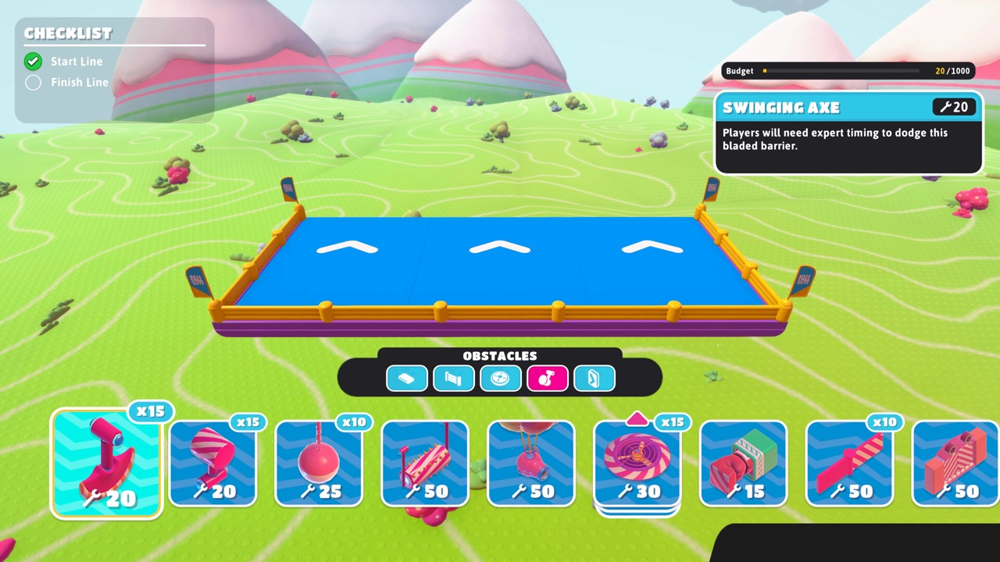 | 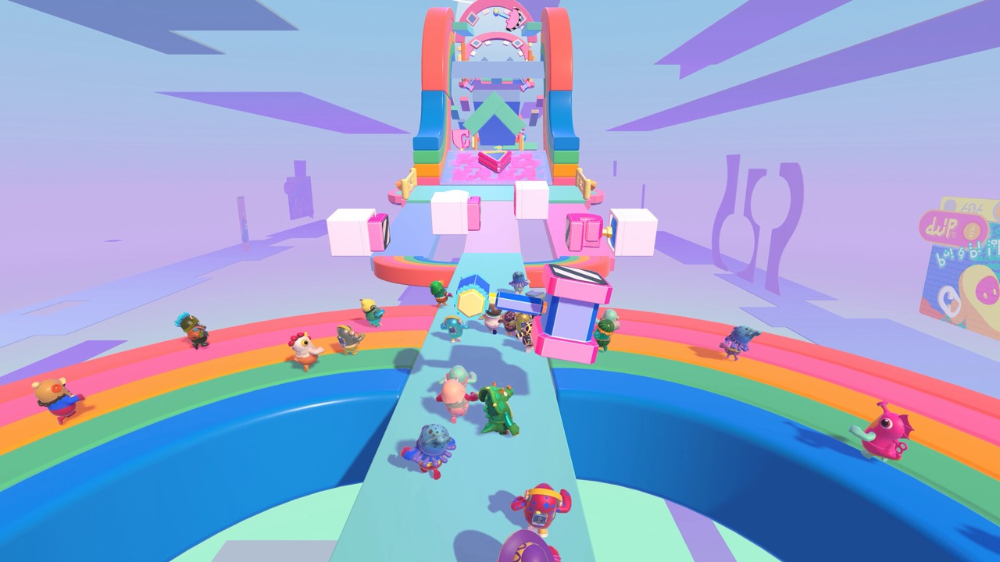 |
|---|---|---|
| 1：円形の闘技場。ピンクの振り子ハンマー | 2：虹色のアーチ状コースを大勢が走る俯瞰 | 3：ビルド画面。障害物パレットと予算バー |

| 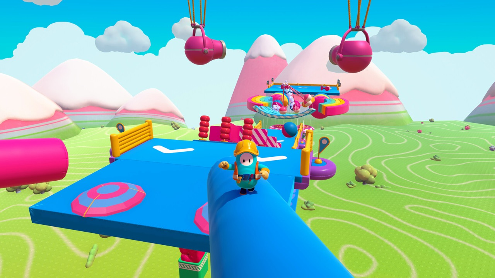 | 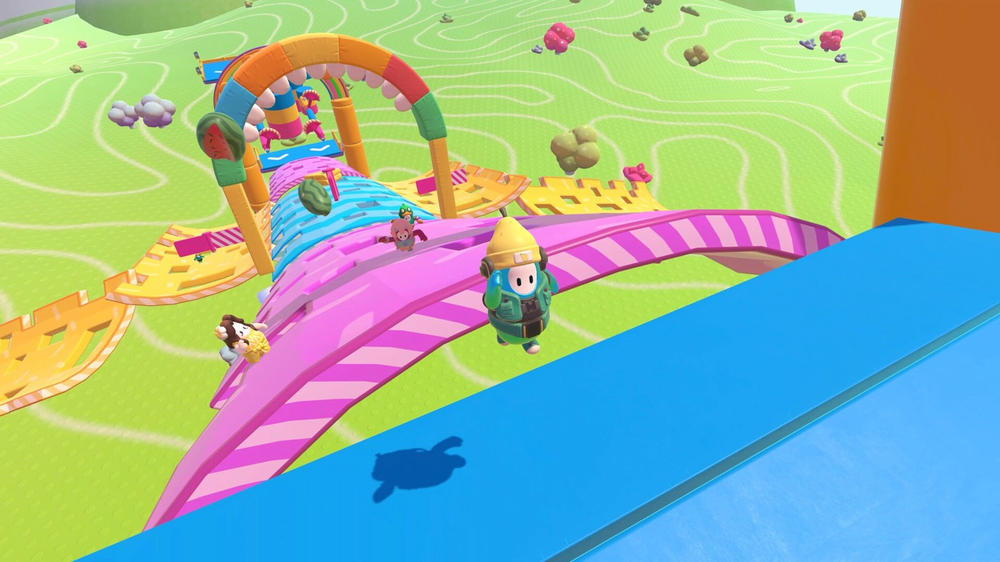 |
|---|---|
| 4：青いトランポリン風の床と吊り下がるハンマー | 5：ピンク・オレンジの縞の坂とスイカのオブジェ |

### Among Us
- 豆型の宇宙服＋バイザー、顔なし
- コンセプトはほぼ一発で決まった（発言あり：Marcus Bromander、初期スケッチ6点）
- 小さなチームで作りやすい簡素な絵柄（報道）
- 色でプレイヤーを区別。色覚対応は後から（配線に形、色名表示）。「色に依存しない識別にしたい」（発言あり）
- VR 版（Schell Games）は原作の「スタイルと手触りを残す」「少しカートゥーン風」（発言あり）
- 宇宙は閉じた船内の舞台装置で、ルール中心（推測）

| 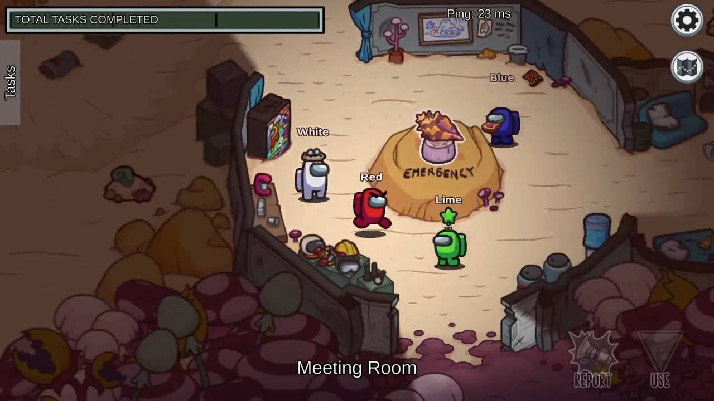 | 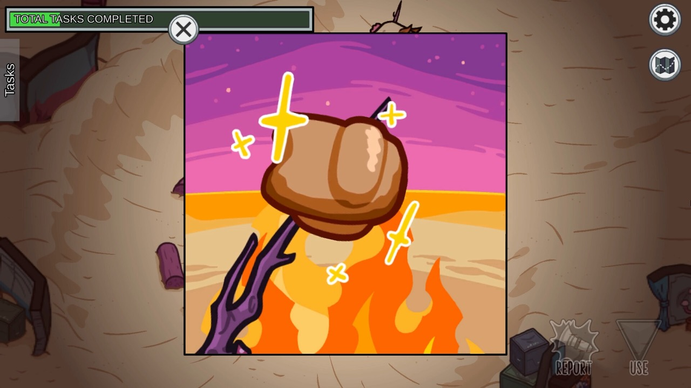 | 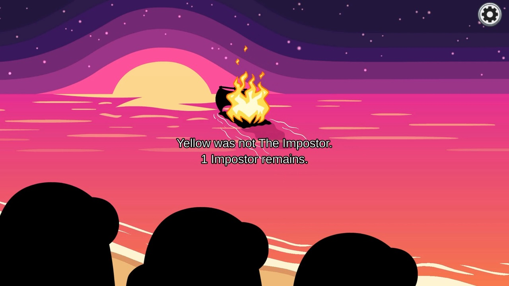 |
|---|---|---|
| 1：会議室の俯瞰。白・赤・青・ライムのクルー | 2：タスク（ミニゲーム）の拡大表示 | 3：終了後の夕日の海。字幕とシルエット |

| 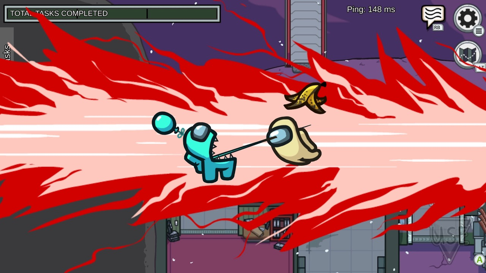 | 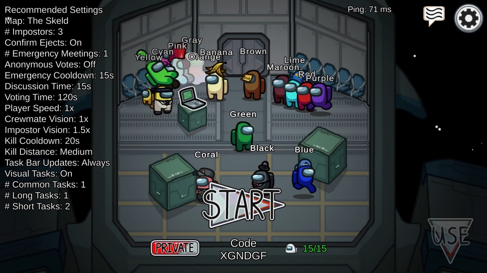 |
|---|---|
| 4：赤いキル演出。水色が黄色を引っ張る | 5：ロビーの START 画面。多色のクルー |

## 4. 似すぎを避ける線引き

| 作品 | やらないこと |
|---|---|
| Overcooked | コック帽、腕がなく手だけ浮く体型、注文札風 UI、厨房風レイアウトや調理動作の再現 |
| Fall Guys | 頭から飛び出す目、ゼリー状の艶・半透明の豆型ボディ |
| Among Us | 顔なしバイザー1枚だけの豆型宇宙服、色だけで見分ける設計 |

## 5. art-direction.md との食い違い

- 席の色（赤・黄・緑）と状態の色（緑・黄・赤）が衝突。赤緑の色覚でも区別しにくい。席の色を状態色と重ならない組み合わせにするか、席アイコンを主にする
- 「豆型の胴」は Among Us・Fall Guys に近い。ルール2・3で距離を取る
- 実名の部品名（CSM、LM、LiOH 缶）は障壁を下げる方針と緊張する。補助ラベルに留める
- 「影を頂点カラーに焼く」と「ソフトシャドウの平行光」が二重。どちらかに決める
- トゥーン・アウトラインなしで読みやすさを出すにはコントラストが要る。16色で足りるか要確認

## 6. まだ分かっていないこと

- 頭身・ポリゴン数・塗り・質感の数値根拠はない。バズの理由も推測
- 精度を上げるなら：
  - 一次情報（開発者講演・公式資料）を探す
  - 高校生数人にキャラ絵を10秒見せて試す
  - 色覚シミュレーションで席の色を確認

## 7. 出典

- 画像ごとの説明と元 URL：[Overcooked](art-ref/overcooked/sources.md) ／ [Fall Guys](art-ref/fallguys/sources.md) ／ [Among Us](art-ref/amongus/sources.md)
- Overcooked：https://mcvuk.com/the-develop-post-mortem-overcooked/ 、https://gamedeveloper.com/design/road-to-the-igf-ghost-town-games-i-overcooked-i-
- Fall Guys：https://waytoomany.games/2020/08/18/interview-with-anthony-pepper-senior-designer-behind-fall-guys/ 、https://gameluster.com/the-truth-behind-the-anatomy-of-a-fall-guys-jelly-bean/
- Among Us：https://www.gamedeveloper.com/art/early-i-among-us-i-character-concepts-depict-the-birth-of-the-bean 、https://developers.meta.com/vr/blog/among-us-vr-schell-games-innersloth-robot-teddy/ 、https://nerdbot.com/2020/10/15/among-us-beta-update-brings-colorblind-feature-and-new-host-options
