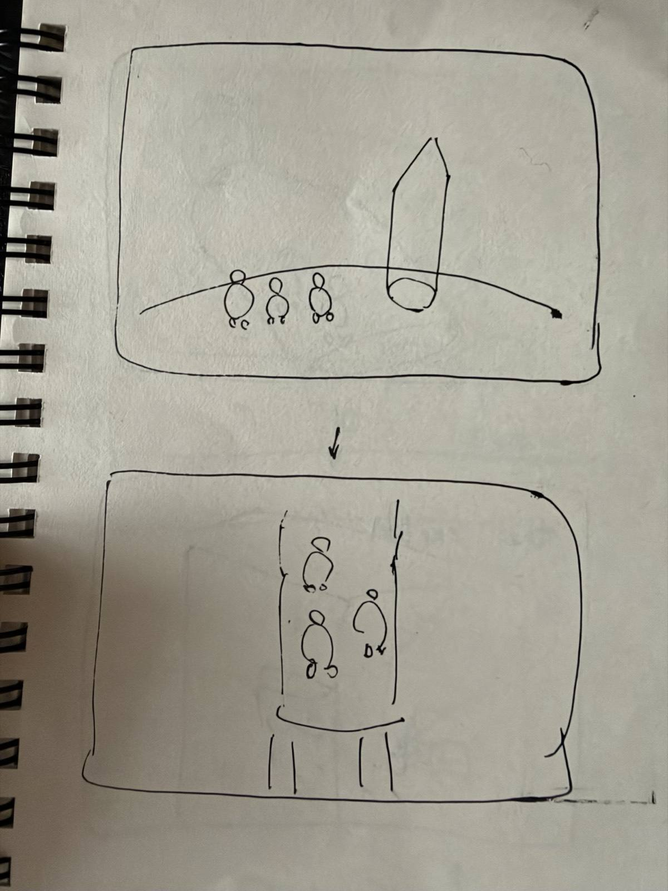
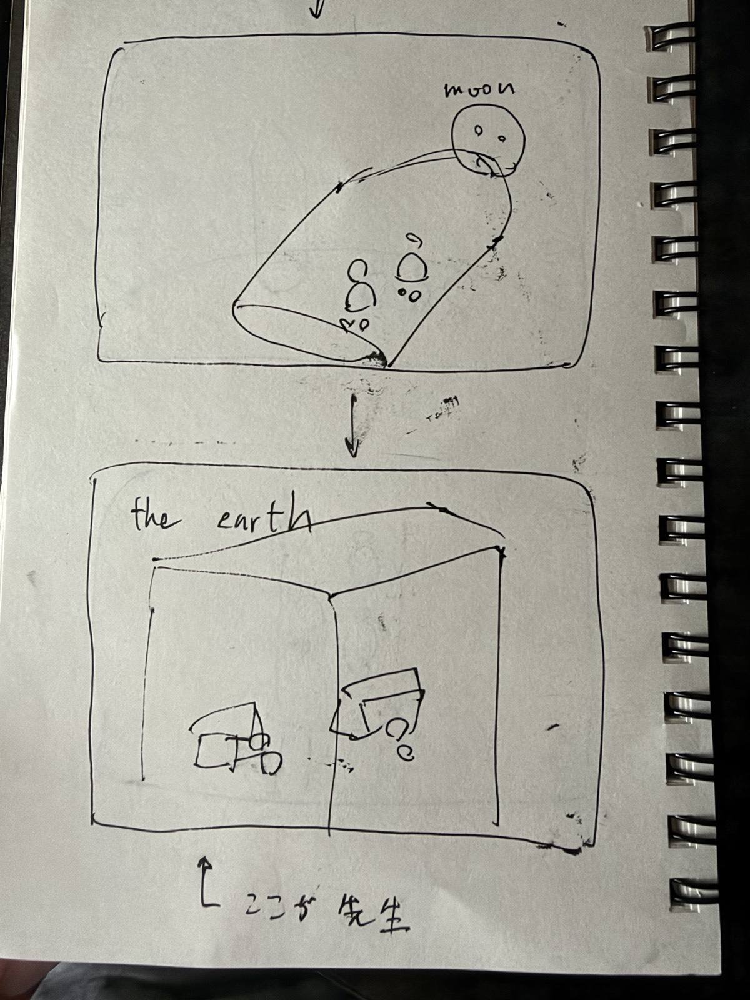
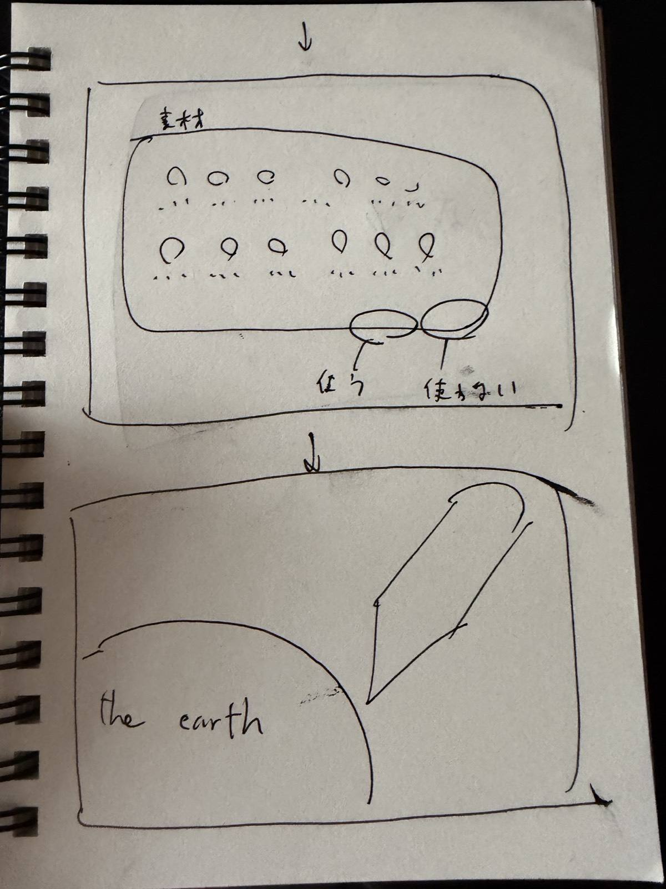
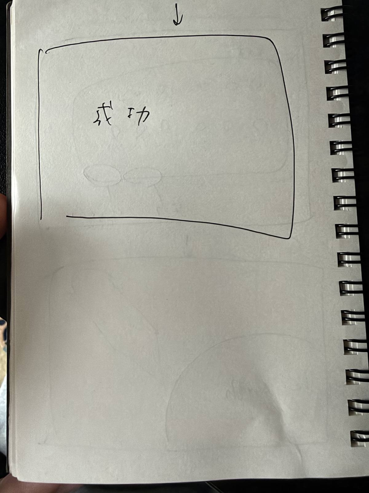

書いた人：iizuka（スケッチ）／ 文書化：Claude ／ 最終更新：2026-11-14

# ゲームの流れ（手描きスケッチ）

iizuka の手描きのイメージを4ページの写真から文書にしました。矢印でつながった順に7場面です。
SPEC の M01〜M12 との対応は、Claude が絵から推測したものです（確認待ち）。

## ゲームの流れ（7場面）

### ページ1：出発

1. **地上のロケットとクルー**：弧を描く地面の上に、クルー3人とロケットが立っている。見送りの場面。
   - SPEC：SPEC になし（M02 の打ち上げ判定の前後にあたりそう）
2. **ロケット内部の断面**：ロケットを横から切った図。中にクルー3人、下に発射台の脚。
   - SPEC：M02 打ち上げ（Ready for launch）の演出にあたりそう

### ページ2：月へ向かう船と管制室

3. **月へ向かう宇宙船**：斜めに飛ぶ宇宙船の断面。中にクルー2人。右上に顔のある月（moon）。
   - SPEC：M03〜M05（巡航・事故前）にあたりそう。2人しか描かれていない点は下の食い違いを参照
4. **管制室（the earth）**：部屋の中に机とコンピュータと人。「ここが先生」と注記がある。
   - SPEC：SPEC になし（ヒューストンの台詞は M06・M09・M10 などで出るが、場面としての管制室はない）

### ページ3：素材の選択と地球への接近

5. **素材の画面**：部品が2段（上5・下6）で並ぶパネル。下に「使う」「使わない」の丸ボタン。
   - SPEC：M01 設計画面にあたるのか、事故後の修理場面なのか未確定（下の質問を参照）
6. **地球に向かう宇宙船**：大きな地球（the earth）の弧に向かって宇宙船が飛ぶ。
   - SPEC：M10〜M12（通信回復から再突入）にあたりそう

### ページ4：成功

7. **「成功」の画面**：成功と書かれた画面。写真の下半分は裏写りで、描かれていない。
   - SPEC：エンディング ED-A または ED-B（生還）にあたりそう。ED-C（失敗）の場面は描かれていない

## SPEC.md・見た目の計画との食い違い

| 項目 | スケッチ | SPEC / 見た目の計画（art-direction.md） |
| --- | --- | --- |
| カメラ | 宇宙船を横から切った断面 | 斜め上からの俯瞰（固定の透視、見下ろし 50°、4席が1画面） |
| 人数 | クルー3人（ページ2の船内は2人） | 4席（1〜4人。3人なら Comms & Power が Mission Planner を兼ねる） |
| 管制室（先生） | 部屋として見せる | 「作らない（2D の通信ウィンドウで代用）」 |
| 出発の場面 | 地上のロケットとクルーから始まる | Saturn V は「余裕があれば」。SPEC は M01 の設計画面から始まる |
| 素材の画面 | 部品を並べて「使う／使わない」を選ぶ | M01 は部品の ± と合計表示で積む設計画面。アポロ13号の「船にある物で直す」場面かは不明 |
| 地球・月の場面 | 月と地球が画面いっぱいに大きく描かれ、月には顔がある | art-direction.md では地球・月は「球＋NASA 画像」で必須。ただし顔を付けるか、画面いっぱいに見せる場面があるかは決まっていない |
| 失敗の場面 | 描かれていない | ED-C（酸素か電力が尽きる）がある |

- 流れは「出発 → 月へ → 管制室 → 素材 → 地球へ → 成功」で、SPEC の「設計 → 巡航 → 事故 → 月の裏側 → 帰還」と順番が近い。ただし事故（M05）、月の裏側の通信途絶（M09）、かき混ぜスイッチ（M04）はスケッチに出てこない。

## 決めること

- [ ] カメラはスケッチの横断面にするか、見た目の計画の俯瞰（50°）のままにするか。場面ごとに変えるか。
- [ ] クルーは3人にするか、SPEC の4席（1〜4人）のままにするか。ページ2の船内が2人なのは意図か。
- [ ] 管制室を場面として作るか、2D の通信ウィンドウで済ませるか。作るなら誰が作るか（art-direction.md の「作らない」を変える）。
- [ ] 出発（地上のロケットと発射台）を作るか。Saturn V を「余裕があれば」から外すか、2D の紙芝居で済ませるか。
- [ ] 素材の画面は M01 の設計画面か、事故後の「船にある物で直す」場面か。「使う／使わない」を選ぶ操作は SPEC のどのコマンドにあたるか。
- [ ] 失敗エンディング（ED-C）と、ED-B（ぎりぎり生還）の場面もスケッチに足すか。
- [ ] 月の顔や地球の弧のような背景は、作る時間があるか（art-direction.md の作る物リストに入れるか）。
