書いた人：iizuka（ガイドライン：Fable 5.2）／ 最終更新：2026-11-15 ／ 更新：iizuka（Fable 5.2、2026-11-14、ダーク/ライトの判断） ／ 更新：iizuka（Opus 5.5、2026-11-15、#168 設計の画面の節） ／ 更新：iizuka（Fable 5.2、2026-11-15、#190 あつ森に寄せる）

# UI ガイドライン（2D の画面）

あつまれ どうぶつの森（Switch）の UI を**見てそう感じるところまで寄せる**（#190。前の版は「方向性だけ」で、ふつうのアプリの見た目になった）。形・模様・カーソル・文字の組み方は基準の画像に合わせて**自分で描く**。任天堂の画像・書体・アイコン・ロゴそのものは使わない（7章）。3D は Overcooked 風（`art-direction.md`）のまま。数値はすべて Canvas の基準 1600×900 での px（iPhone 横画面では約 0.48 倍）。

## 0. 基準の画像の一覧（`docs/reference/art-ref/acnh/`）

この文書の見た目の決まりは、すべて下の 12 枚のどこかを基準にしている。本文では【01】〜【12】と書く。**基準の画像が無い見た目の決まりは作らない**（足すときは先に画像を足す）。画像は見比べるためだけに置く。ゲームに入れない、なぞらない（出典は同じフォルダの `SOURCES.md`）。**選択の UI の主な基準は【09】【10】【11】【12】**。

| 記号 | ファイル | 何の基準か |
|---|---|---|
| 【01】 | `01_nookphone_home.jpg` | アイコンの**色つきの台**（角の丸い色面＋単純な絵。台ごとに色が違う）、3×3 の並び、右下の操作ヒントのピル |
| 【02】 | `02_bubble_craft_plain.jpg` | 名前タグの無い吹き出し（影・枠・しっぽが無い）、短い文は中央、英語の文は小文字まじり |
| 【03】 | `03_bubble_name_tags.png` | 台詞の中の**色文字**（固有名詞）、名前タグの色が話す人で違う（青・白）、行間の広さ |
| 【04】 | `04_menu_tabs_plants.jpg` | 画面の上の帯の下の**波の縁**、帯の中の同じ色の濃淡の柄、選んだタブの上の名前の札 |
| 【05】 | `05_menu_craft_materials.jpg` | **パネル**（明るい内ふち、中に横縞の濃淡）、**主ボタン**（青緑・斜めの縞・明るいふち・右下に手、`Craft it!`）、英語の見出しの大きさ |
| 【06】 | `06_menu_shop_list_bells.jpg` | **濃い青のテーマ色に白い文字**の画面、縦のリスト（選んだ行は斜めの縞の帯、左の外に手、行の下の点線、右寄せの値段） |
| 【07】 | `07_menu_dressup_grid.png` | 淡い波の地模様、グリッドの選択のもう1例 |
| 【08】 | `08_bubble_zl_hint.jpg` | ワールドの上に浮く**小さな吹き出し**（一言だけの豆形＋小さな丸のしっぽ） |
| 【09】 | `09_shop_grid_cursor_bells.png` | **グリッドの選択**（枠の無い品物、右下に指さしの手、右上に青緑のチェック、左上に大きな品名の札）、品物の下の**値段**（小さなアイコン＋数字）、**タブの帯**（もこもこした1本の帯にアイコン、選んだタブの上に名前の札）、右上の**残高のチップ**（色の面＋明るい数字＋右下に単位の札＋上にアイコン）、下の**合計のピル**（小さな見出し＋点線＋アイコン＋数字）、右下の**操作ヒント**と青緑の決定ボタン、画面の端の**大きな柄** |
| 【10】 | `10_pocket_bubble_choice_menu.png` | **選択肢の吹き出し**（黄みの豆形、選択肢は文字だけを縦に、選んだ行の文字の後ろにマーカーの帯、左に指さしの手）、雲のような大きな吹き出し、**丸い枠**の並び（空きは淡い丸だけ）、丸いアイコンのボタン |
| 【11】 | `11_diy_recipe_cards_materials.png` | **色違いのカード**の並び（細い内側の線、選んだカードは大きく、右下に手）、左上の**波形の見出しの帯**、右の欄の**材料の行**（角丸の行の帯＋アイコン＋名前＋点線＋色の箱の数 ＋ `/ 2`）、見出しの下の点線 |
| 【12】 | `12_dialogue_name_tag.png` | **会話の吹き出し**（下の辺が波打つ大きな形、幅は画面の約 65%・高さ約 30%）、**名前タグ**（オレンジ、約 −8° 傾けて左上にかぶせる）、台詞の文字（茶、画面の高さの約 5%、左に広い余白）、下中央の ▼ |


### 基準の画像（全部）

| | | |
|---|---|---|
| 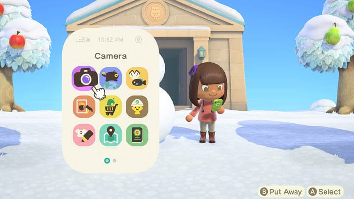<br>【01】 | 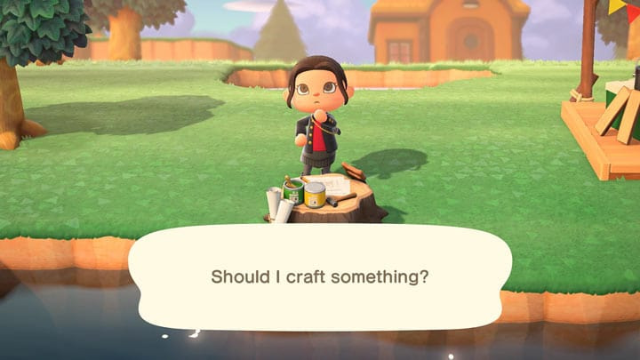<br>【02】 | 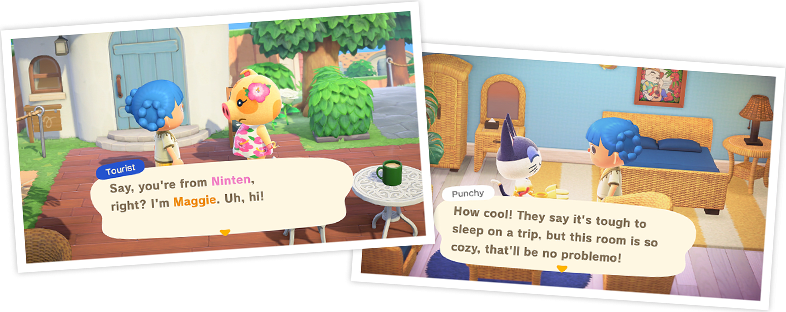<br>【03】 |
| 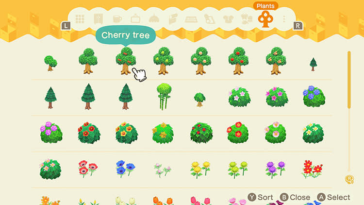<br>【04】 | 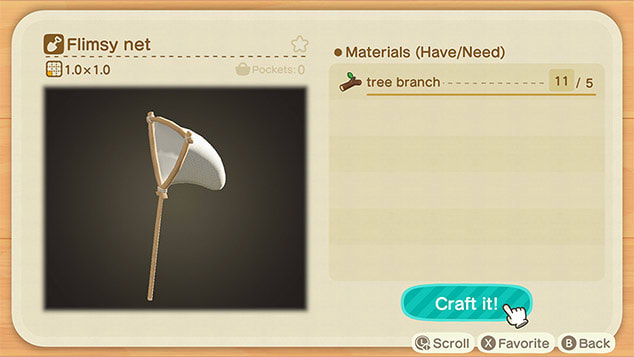<br>【05】 | 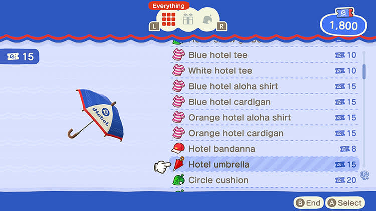<br>【06】 |
| 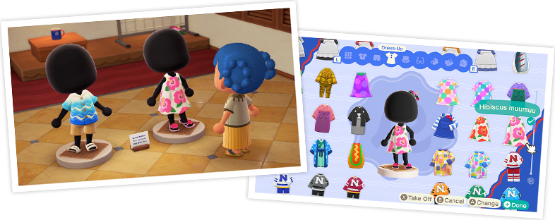<br>【07】 | 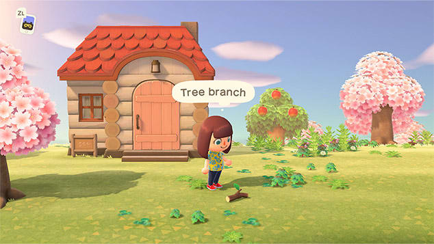<br>【08】 | 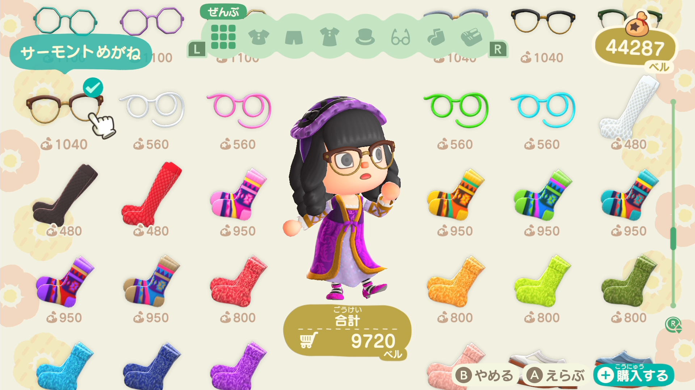<br>【09】 |
| 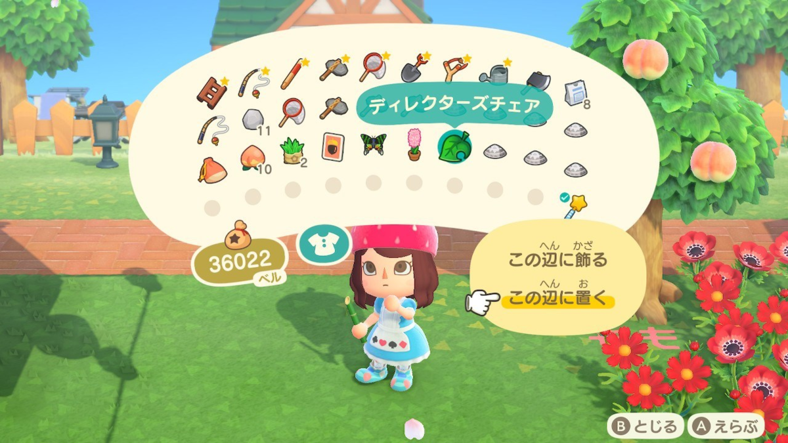<br>【10】 | 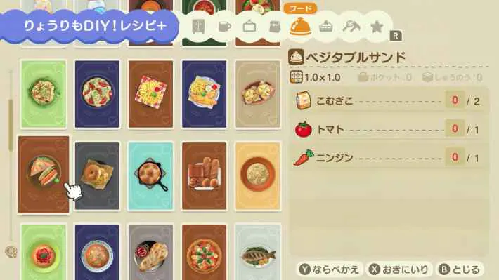<br>【11】 | 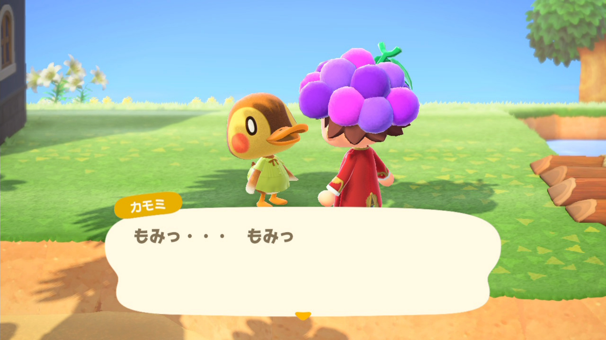<br>【12】 |

今の画面と比べたときの差（`docs/design/lookdev/ui146b_*.png`）：辺のまっすぐな角丸とピルだけでできている／どの部品にも下にずらした影／紺の ExtraBold の大文字／線だけの単色アイコン／選んだ物は「紺で塗りつぶす」か「枠の色を変える」だけで、手もチェックも品名の札もマーカーも無い／面がべた塗り。**あつ森に見えない理由はこの6つ**。

## 1. 原則（あつ森らしさを生む 15 の要素）

|  |  |  |
|---|---|---|

↑ 全体の雰囲気の基準：【12】波打つ吹き出しと名前タグ、【05】影の無いパネルと縞の主ボタン、【04】帯の波の縁とタブ


各行は「基準 → このゲームでの作り方」。法的に避けることは 7章にまとめた。

| # | 要素 | 基準（画像のどこ） | このゲームでの作り方 |
|---|---|---|---|
| 1 | **波打つ形** | 【12】吹き出しの下の辺、【10】雲形の吹き出しと選択肢の豆形、【09】残高のチップともこもこのタブの帯 | 吹き出し・選択肢・チップ・タグ・アイコンの台は、辺がふくらみ左右が同じでない形（`blob_*` の sprite、5章）。幾何学の角丸は、カード（【11】）・行の帯（【11】）・入力欄だけ |
| 2 | **影を付けない** | 【12】【10】【09】【11】：吹き出しにもチップにもカードにもボタンにも、下にずらした影が無い | 影（`shadow` 6px）をやめる。面の区別は色の差とふち（3番）で付ける |
| 3 | **明るい内ふち・細い内側の線** | 【05】パネルの外周と主ボタンの外周、【11】カードの内側の線 | パネルは外周 12px を一段明るく。主ボタンは 5px の明るいふち。カードは内側 6px に細い線（2px、面より明るい色）。紺の 3px の枠線（今の副ボタン・入力欄）はやめる |
| 4 | **同じ色の濃淡の模様** | 【09】画面の端の大きな花、【05】パネルの中の横縞と主ボタンの斜めの縞、【04】帯の柄、【07】淡い波 | べた塗りの広い面を作らない。画面の地＝端に大きな柄（月・星・惑星の輪。自分で描く）、パネルの中＝横縞、主ボタンと選んだ行＝斜めの縞。模様の色は**面と同じ色相で明るさだけ 4〜10% 違う** |
| 5 | **波の縁・波形の帯** | 【11】左上の見出しの帯、【04】上の帯の下の縁、【06】上下の縁 | 画面の見出しは左上の波形の帯（色の面に白い文字）。画面の端に付く面（設計の棚、船内の席の盆）は、まっすぐ切らず波の縁（`wave_edge`）で終える |
| 6 | **指さしの手** | 【09】【11】選んだ物の右下、【10】選んだ選択肢の左、【05】主ボタンの右下 | 1画面に1つ。**今選ばれている物か、次に押す物**に乗る。絵は宇宙服のグローブ（クルーのモデルと同じ丸い手。自分で描く）。3章「選ぶ」 |
| 7 | **選んだ印は4種類** | 【09】チェックと品名の札、【10】文字の後ろのマーカー、【11】大きくなるカード、【06】縞の帯 | グリッド＝品名の札＋手（決まっている物にチェック）／選択肢＝マーカー＋手／カード＝大きく＋手／縦のリスト＝縞の帯＋手。**面を紺で塗りつぶす選択・枠の色だけ変える選択をやめる** |
| 8 | **品物に枠を付けない、数は下か右に小さく** | 【09】品物の下の値段、【10】品物の右下の個数、【11】`0 / 2` | 選ぶ物をカードや影で囲まない。値段・重さは品物の下に小さなアイコン＋数字（補助の色）。個数は色の箱 |
| 9 | **材料の行** | 【11】右の欄、【05】`tree branch ---- 11 / 5` | 1行＝アイコン＋名前＋点線＋色の箱の数＋`/ 上限`。行は角丸の淡い帯。行ごとの影・枠を作らない |
| 10 | **アイコンは色つきの台か丸い枠に** | 【01】色つきの台、【10】淡い丸い枠と青緑の丸いボタン | 単色の線のアイコンをそのまま置かない。意味を持つアイコンは色つきの台（`blob_disc`）に白い絵。並びの中の選べる物は淡い丸い枠の上 |
| 11 | **タブは1本のもこもこの帯** | 【09】上の帯、【11】【04】選んだタブの上の名前の札 | アイコンだけを1本の帯に並べる。選んだタブだけ色つきで、上に名前の札。タブ1つずつのカードは作らない |
| 12 | **茶色の文字、1つの太さ、小文字まじり** | 【12】【10】【11】：明るい面の文字は茶、色の面では白。【02】【05】【06】`Should I craft something?` `Craft it!` `Flimsy net` | 明るい面の文字は茶（`text`）。**大文字だけの言葉をやめる**（`CREATE ROOM` → `Create room!`）。見出しもボタンも丸い書体の太字1種類。大きさの差は小さく、色と場所で主従を付ける |
| 13 | **大きな台詞、広い余白** | 【12】：文字は画面の高さの約 5%、左の余白は約 90px（1920 幅で）、吹き出しは幅 65%・高さ 30%。【03】行間は約 1.5 | 台詞を 28 → 36、行間 1.3 → 1.5。吹き出しは画面の幅の 55〜65% |
| 14 | **名前タグと ▼** | 【12】【03】 | 今の作りを残し、形と傾きを替える（タグ＝`blob_pill`、−6°。▼＝角の丸い三角）。話す人でタグの色を替える |
| 15 | **数と補助の操作は隅のピルへ** | 【09】右上の残高・下の合計・右下の操作ヒント、【10】【11】右下の操作ヒント | 数（残りの予算・重さ・合言葉・得点）は「数のチップ」。補助の操作（Skip・設定）は右下の「ヒントのピル」。真ん中に置かない |

### 船内の計器は濃紺のまま（あつ森との両立）

|  |  |
|---|---|

↑ 濃い色の画面の基準：【06】濃い青のテーマ色に白い文字のリスト、【01】アイコンの色つきの台


- 【06】は**濃い青のテーマ色に白い文字**の画面、【11】も濃い色のカードや帯に白い文字で、それでもあつ森に見える。あつ森らしさは面の明るさではなく、形・ふち・模様・手・選んだ印にある。だから濃紺は「宇宙のテーマ色」として残し、**作りを基準に合わせる**
- 計器（ゲージ・地図・タイムライン）：面は `hudFace` のまま、形を `blob_panel` に。小さな星の模様を `hudText` の 6% で敷く（【07】の地模様の作り）。アイコンは色つきの台（【01】）。影なし。地図の A/B の時間は数のチップ（【09】）
- 席のパネル（下）：今の四角い紺の帯・四角い席の札・影つきカードをやめる。クリームの**盆**（上端が波の縁、【04】【06】）に替え、席の名前は傾いた名前タグ（席の色、【12】）。中の選択は 3章「選ぶ」
- 前の版の判断は変えない：声（吹き出し）・操作・警告の帯は船内でも明るい／暗い面の文字はいつも `hudText`／危険は文字色でなく、行の後ろの赤・縞・アイコン・言葉で伝える／全部をダークにはしない

### 遊びやすさの決まり（あつ森由来ではない。前の版のまま）

これは見た目ではなく、このゲームで遊べるための決まり。基準の画像は無い。
- 状態は必ず「色＋アイコン」、席は必ず「色＋形（▲●■◆）」。色だけで伝えない。**安全＝青緑／注意＝オレンジ／危険＝クリムゾン＋斜めの縞＋`warning`**（#109）。席の4色は席の印（バッジ・名前タグ・盆の札）だけ
- 押せる範囲は最小 96×96。文字は 22 より小さくしない。1つの部品に文は1行
- 主ボタンは画面に1個、警告の帯は同時に1本、危機は1つだけ前面（#71）
- 数字は幅を固定した箱に右寄せ（桁ぶれを防ぐ）

## 2. デザイントークン

### 色

`modeling/core/palette.json` の色を使う。UI 専用に足した色は「UI 専用」と書いた（`palette.json` は変えない）。あつ森の色コードは測らない・使わない（色の**役割**だけ基準に合わせる）。

| トークン | 値 | 使い道（基準） |
|---|---|---|
| `bg` | `#F2E3C6`（cream） | 画面の地。端に大きな柄を `bgDeep` で（【09】） |
| `bgDeep` | `#E7D4AE`（UI 専用。cream を暗く） | 地の柄、淡い丸い枠（【10】）、点線、副ボタンのふち |
| `panel` | `#FBF7EE`（white） | 吹き出し・パネル・盆の面。色面の上の「白」もこれ（【12】【05】） |
| `panelBand` | `#F4EDDC`（UI 専用。white を暗く） | パネルの中の横縞（【05】）、材料の行の帯（【11】）、入力欄の面 |
| `choice` | `#FBEFC0`（UI 専用。黄みのクリーム） | 選択肢の吹き出しの面（【10】。会話の吹き出しより黄色い） |
| `mark` | `accent` の 45% | 選んだ選択肢の文字の後ろのマーカー（【10】）、数の色の箱（【11】の `0`） |
| `text` | `#5C4A3A`（UI 専用。茶） | **明るい面の文字とアイコン**、数のチップの面（【12】【10】【09】。panel 上で約 8:1、bg 上で約 7:1） |
| `textSub` | `#705C49`（UI 専用） | 補助ラベル、品物の下の値段（【09】。panel 上で約 5.9:1） |
| `ink` | `#1D2D50`（navy） | **暗い面の色**（計器・部屋の宇宙）。明るい面の文字には使わない |
| `line` | `#C8CCD4`（gray_light） | 押せない物の面、ゲージの溝 |
| `go` ／ `goLight` | `#2A9D8F`（teal）／`#4DB8AA`（UI 専用） | 主ボタン・品名の札・チェック・安全・完了（【09】【05】）。`goLight` は主ボタンの縞とふち |
| `accent` | `#F28C28`（orange） | 注意・▼（【12】）・選んだタブの名前の札（【11】）・台詞の数字（32px 以上の太字だけ） |
| `danger` | `#C81E4A`（UI 専用） | 危険・失敗（白文字で 5.3:1） |
| `hudFace`／`hudText`／`hudSub`／`hudGroove`／`hudSeg` | 前の版のまま | 船内の計器（【06】の作りで） |
| 台とカードの色 | `go`・`accent`・`ink`・`text`・`plum #8A6BBE`（UI 専用） | アイコンの台（【01】）、色違いのカード（【11】）、見出しの帯（【11】）。隣どうしを同じ色にしない。状態（注意・危険）を示す台は `accent`・`danger` |
| 席 | 赤 `#E4572E` ▲／緑 `#6BBF59` ●／黄 `#FFC857` ■／青 `#3A86FF` ◆ | 席の印の面だけ。文字色・台の色には使わない |

- `shadow` は使わない（原則 2）。`Scrim`（重ねの後ろ）は残す

### 形・余白・文字

| 項目 | 値（基準） |
|---|---|
| 波打つ形 | `blob_bubble`（会話の吹き出し。【12】）／`blob_panel`（選択肢・パネル・盆・計器。【10】【05】）／`blob_pill`（名前タグ・品名の札・チップ・ボタン。【12】【09】）／`blob_disc`（アイコンの台・丸い枠・タブの帯の1こぶ。【01】【10】【09】） |
| 角丸（幾何学） | カード 16（【11】）／材料の行の帯 12（【11】）／入力欄 16／数の色の箱 8（【11】） |
| 内ふち | パネル 12（面より明るい白 55%。【05】）／主ボタン 5（【05】）／カードは内側 6 に 2px の線（【11】） |
| 縞 | 斜め 45°、縞 16・間 16。主ボタン＝`goLight` 35%（【05】）、縦のリストの選んだ行＝面より明るい色 45%（【06】。暗い面では `hudText` 14%） |
| 横縞（パネルの中） | 高さ 64 ごとに `panel`／`panelBand`（【05】） |
| 点線 | 太さ 3、長さ 8・間 8、`bgDeep`（色の面の上では `panel` の 60%）（【11】見出しの下と材料の行、【09】合計のピルの中） |
| 余白 | 8 の倍数。パネルの内側 32（内ふち 12 を含む）、画面の端から 32 |
| 書体 | **Nunito ExtraBold**：見出し・ボタン・名前・札・選択肢（Font Asset ができるまで Nunito Bold で代用）／**Nunito Bold**：台詞・本文・補助／**Baloo 2 ExtraBold**：タイトルのロゴと数字だけ。基準：【02】【05】【06】【12】はどれも丸い書体の同じ太さ |
| 大文字 | 使わない。文の頭と固有名詞だけ大文字（`Create room!` `Mass` `Houston`）（【02】【05】【06】）。例外：頭字語（`NASA GMAT` `CO₂`）、`T+`、ルートの A/B |
| 台詞 | 36、行間 1.5、最大3行、左の余白 72（【12】【03】） |
| 選択肢・品名の札・ボタン | 32（【10】【09】【05】） |
| 行の名前・見出し | 30（材料の行の高さ 64。【11】）／画面の見出しの帯 36（【11】。72 をやめる） |
| 補助ラベル・値段・ヒント | 22〜26（【09】値段、右下のヒント） |
| 数字 | Baloo 40（数のチップ・ゲージ。【09】）／56（カウントダウン） |
| アイコン | 台 48（行）／64（タブ）／96（グリッド）／40（補助）。絵は台の 60%、`panel` 色 |
| 指さしの手 | 72×72（【09】で画面の高さの約 8%）。向きは2つ：選択肢と縦のリスト＝右向き（【10】【06】）、グリッド・カード・ボタン＝左上向き（【09】【11】【05】） |

## 3. 部品

### 選ぶ（いちばん大事）

|  |  |  |
|---|---|---|

↑ 選ぶ UI の基準：【09】グリッドと指さしの手・品名の札・チェック、【10】選択肢の吹き出しとマーカー、【11】カードと材料の行（点線と「0 / 2」）


主な基準：【09】（グリッド）、【10】（選択肢）、【11】（カードと材料の行）。

- **手は1画面に1つ**。乗る先は ①今選ばれている選択肢 ②選ぶ物が無い画面では主ボタン（【05】）。タップした物へ動いてから決まる。マウスでは乗せた物へ動く
- **グリッドの選択**（横に並ぶ、絵で選ぶ物。【09】【10】）：品物は淡い丸い枠（`bgDeep` の `blob_disc`、【10】）の上、カードや影なし。手は右下・左上向き。品物の上か左上に**品名の札**（`go` に白文字 32、高さ 64、下に小さな三角、−3° 傾ける。【09】【10】）。今決まっている物の右上に**チェック**（`go` の丸 40 に白い ✓。【09】）
- **選択肢**（2〜4 個の言葉から1つ。押すとすぐ決まる。次へ進むだけの物は主ボタン。【10】）：`choice` の豆形に、選択肢の文字だけを縦に（行の高さ 80、中央）。選んだ行は文字の後ろに**マーカー**（`mark`、高さは文字の下半分〜全体、角丸、文字の幅＋左右 16）。手は左の外・右向き。ボタンの形にしない
- **カードの選択**（中身に数字や絵がある選択肢。【11】）：色違いのカード（角丸 16、内側の線）。選んだカードは 1.12 倍で手前、手は右下。選んでいないカードは小さいまま（暗くしない）
- **材料の行**（個数を決める物。【11】）：行の帯＋台＋名前＋点線＋色の箱の数＋`/ 上限`、右に − ＋。最後に触った行に手（左の外・右向き）
- **押せない物**：台と文字を `line`／`textSub` に、右上に `lock` の小さな台。手は乗らない
- 動きと音は静止画から読めないので、ここでは決めない（末尾「基準の画像が無い物」）

### 部品の表

|  |  |  |  |
|---|---|---|---|

↑ 吹き出し・名前タグ・小さな吹き出し・地模様の基準：【02】【03】【08】【07】


| 部品 | 見た目（基準） |
|---|---|
| 会話の吹き出し | `blob_bubble`、`panel`、影・枠・しっぽなし（【12】【02】）。幅は画面の 55〜65%、高さ 200〜260（船内だけ 3D を見せるため 180）。内側 左右 72・上下 36。短い1行は中央（【02】）、2行以上は左寄せ（【12】）。左上に名前タグ、下中央に ▼。固有名詞は `go`、数字は `accent`（【03】） |
| 名前タグ | `blob_pill`、高さ 48、白文字 26、−6° 傾け、吹き出しの左上の角に半分かぶせる（【12】）。色は話す人ごと（【03】【12】）：Houston＝`go`、危機のとき＝`danger`、クルー＝席の色 |
| ▼ | 角の丸い三角 32×22、`accent`、下中央で吹き出しの縁に半分かぶせる（【12】） |
| 小さな吹き出し | `blob_pill`＋小さな丸のしっぽ。名前や一言だけ（【08】）。部屋の画面のクルーの名前 |
| 品名の札 | `blob_pill`、`go`、高さ 64、白文字 32、下に小さな三角、−3°（【09】【10】） |
| 選択肢の吹き出し | `blob_panel`、`choice`、内側 32、行の高さ 80、文字 32 `text`、選んだ行にマーカーと手（【10】）。会話の吹き出しの右下か、選ぶ物のそばに出す |
| パネル | `blob_panel`、`panel`、内ふち 12、中に横縞、影なし（【05】）。見出し（30、左にアイコンの台 40）の下に点線（【11】） |
| カード | 角丸 16、色は「台とカードの色」から、内側 6 に 2px の線（面の色を明るくした色）、文字とアイコンは `panel`（【11】） |
| 見出しの帯 | 画面の左上。色の面（`plum` か `go`）、高さ 80、右の端と下の辺が波、白文字 36（【11】） |
| 主ボタン | `blob_pill`、高さ 96、幅 320 以上、`go`＋斜めの縞＋ふち 5（`goLight`）、白文字 32、文末に `!`（【05】`Craft it!`）。左のアイコンは丸の中の絵1つまで（【09】`＋ 購入する`）。影なし。手が乗る。画面に1個 |
| 副ボタン | `blob_pill`、高さ 72、`panel` の面＋ふち 5（`bgDeep`）、`text` の文字 30（【09】右下のクリームのピル）。紺の枠線なし |
| ヒントのピル | 右下に横に並べる。高さ 56、`panel` の 90%、左に小さな丸（`text` の面に白いアイコン 24）＋言葉 26（【09】【10】【11】右下）。Skip・設定・戻るなど補助の操作。押せる範囲は 96 |
| 丸いアイコンのボタン | `blob_disc` 96、`go` の面に白い絵 56、ふち 5（`panel`）（【10】の服のボタン）。今の `IconButton` を替える |
| 数のチップ | `blob_pill`、高さ 88、面 `text`（暗い画面では `accent`）、数字 Baloo 40 `panel`。上にアイコンの台 48 を半分かぶせ、右下に単位の札（`panel` の小さなピル、文字 22 `text`、−4°）（【09】【10】右上の残高）。残りの予算・重さ・合言葉・得点 |
| 合計のピル | 数のチップと同じ面。中に小さな見出し 22 → 点線 → アイコン＋数字（【09】下）。設計の合計、レポートの合計点 |
| タブの帯 | `blob_disc` 112 をタブの数だけ 16 ずつ重ねて並べた1本の帯（もこもこの縁。【09】）、面 `bgDeep`。中にアイコン 56（`textSub`）。選んだタブはアイコンを `accent` の台 80 に、上に名前の札（`accent`、高さ 40、文字 22 白。【09】【11】）。L/R の札は付けない（コントローラーが無い） |
| 材料の行 | 高さ 64（− ＋ が付く行は 96）。帯 `panelBand` 角丸 12。台 48 ＋ 名前 30 ＋ 点線 ＋ 色の箱（`mark`、角丸 8、数字 30）＋ `/ 上限`（`textSub`）（【11】） |
| 値段 | 品物の下か名前の下。小さなアイコン 24 ＋ 数字 24、`textSub`（【09】） |
| 丸い枠 | `blob_disc` 96、`bgDeep`、間 24。空きは枠だけ（【10】） |
| 席の印 | 前の版のまま（円に ▲●■◆。黄だけ形を `ink`）。円を `blob_disc` に。自分の席は外に `text` の輪 4 |
| ゲージ | 前の版のまま（高さ 28 のピル、溝・中身・生還ライン・危険の縞）。あつ森にゲージの基準は無いので形は変えない。左のアイコンだけ色つきの台 48 に（【01】） |
| 警告の帯 | 前の版のまま（上の中央、高さ 72、同時に1本）。形を `blob_pill` に、ふち 5（`panel`）（【09】残高のチップの作り） |
| 入力欄 | 角丸 16、高さ 72、面 `panelBand`、枠なし（入力中だけふち 5 `go`）、文字 30（【11】の行の帯の作り） |

### 画面ごとの選択の替え方

| 画面 | 今（`ui146b_*`） | 替える（基準） |
|---|---|---|
| タイトル | 影つきパネルに入力2つ、`CREATE ROOM`（主）、紺の枠の `JOIN`、右上に DEV の丸ボタン | 入力2つはパネル（【05】）の中の行の帯（【11】）。その下に**選択肢の吹き出し**（【10】）：`Create a room`／`Join with a code`。押すとすぐ決まる（今の2つのボタンと同じ動き）。手は `Create a room` に乗り、合言葉が4桁そろうと `Join with a code` へ動く。そろうまで `Join with a code` は押せない物の見た目。DEV は右下のヒントのピル（【09】） |
| 部屋 | オレンジの `ROOM 1234`、名前の札4つ、`START MISSION` | 合言葉＝数のチップ（上に鍵の台、右下に `Room` の札。【09】）。人数も同じ形。名前の札＝小さな吹き出し（【08】）。`Start mission!` は主ボタン、手が乗る（【05】） |
| ブリーフィング | 吹き出しの右下に紺の枠の `SKIP` | 吹き出しは【12】の大きさ（幅 65%・高さ 260・文字 36）。`Skip` は右下のヒントのピル（【10】） |
| 設計（#168。今は `design3d_*.png`） | タブ＝角丸のカード4枚（選ぶと紺）、部品＝影つきカード（積むと `go` の枠）、2択＝紺で塗るピル、お財布と重さのピル、`LAUNCH CHECK` のパネル | 左上の小見出しを見出しの帯 `Build your ship` に（【11】）。タブ＝もこもこの帯（【09】）。部品＝**材料の行**（【11】）：台＋名前＋点線＋色の箱の数＋`/ 上限`、名前の下に値段（重さ・費用。【09】）、右に − ＋（1個までの部品はトグル）。1個以上積んだ行は枠ではなく台の右上にチェック（【09】）。最後に触った行に手。ロケットと軌道＝**選択肢の吹き出し**（【10】）：`Small rocket`／`Large rocket`、選んだ行にマーカーと手、行の右に値段。お財布・重さ＝数のチップ（上にアイコンの台、右下に単位の札 `left`。【09】）。打ち上げチェック＝パネル（【05】）、✓ はチェックの丸（【09】）。`Ready for launch!` は主ボタン |
| 船内の席のパネル | 四角い紺の帯、影つきカード6枚、選んだカードは紺で塗る、四角い席の札 | クリームの盆（上端が波の縁。【04】）＋席の名前タグ（【12】）。船の向きなど「1つ選ぶ」物＝**グリッドの選択**（丸い枠 96 にアイコン、今の向きにチェック、品名の札、右下に手。【09】【10】）。スイッチ＝材料の行にトグル（【11】）。Ignite など1回押す物＝盆の右端に主ボタン（【05】） |
| ルート A/B | Planner のカードの中のボタン2つ | **カードの選択**（【11】）：色違いのカード2枚（A＝`go`、B＝`plum`）、中に A/B の大きな字・名前・家までの時間・燃料。選んだカードは大きく＋手＋右上にチェック（【09】）。決まった後は選ばなかった方を `line` に |
| エンディング | 紺の `SCORE` ピルと `SEE THE REPORT` | 得点＝数のチップ（上にトロフィーの台、右下に `pts` の札。【09】）。`See the report!` に手（【05】）。3つの数字のカードは色違いのカード（【11】） |
| レポート | 影つきパネル3枚、`REDESIGN AND FLY AGAIN` | 左上に見出しの帯 `Mission report`（【11】）。パネル3枚（【05】）、各行＝材料の行（点線＋右寄せの数。【11】）、得点の合計＝合計のピル（【09】）。`Fly again!` は主ボタン、手が乗る（【05】） |

## 4. アイコンの割り当て（Ionicons filled。名前は `svg/` のファイル名）

絵そのものはあつ森由来ではない（MIT の Ionicons）。置き方は原則 10：必ず色つきの台（【01】）か丸い枠（【10】）に載せる。

| 概念 | アイコン | 概念 | アイコン |
|---|---|---|---|
| 電力 | `flash` | 電池の残り | `battery-half` |
| 温度 | `thermometer` | CO2 | `cloud` |
| 燃料 | `water` | 点火 | `flame` |
| 通信 | `radio` | 通信途絶 | `cloud-offline` |
| 警報 | `notifications` | 注意／危険 | `alert-circle`／`warning` |
| スイッチ | `toggle` | 押せない（鍵） | `lock-closed` |
| ロケット | `rocket` | 地球／月／太陽 | `earth`／`moon`／`sunny` |
| 熱シールド | `shield` | 姿勢（向き） | `compass` |
| カメラ | `camera` | 時計／残り時間 | `time`／`timer` |
| チェック／バツ | `checkmark-circle`／`close-circle` | 席／人数 | `person`／`people` |
| 送信 | `send` | ルート | `git-branch` |
| 科学 | `flask` | スコア | `trophy` |
| 質量／コスト | `barbell`／`cash` | 部屋に入る／作る | `enter`／`add-circle` |

無いもの・代用：
- 酸素 → 文字 `O2`（Baloo 2 を円のチップに入れる）。しずくの `water` は水に見え、燃料とも重なる
- バルブ → `aperture`。Ionicons にバルブが無い。絞りの羽根が「開け閉めする輪」に見える（`lock-closed` は「押せない」に使う）
- 分光計 → `prism`（光を分ける形）／レーダー → `scan`（専用が無い。枠で囲む形を「探す」に当てる）／フィルター → `funnel`（こす形）

## 5. Unity での作り方
- **UGUI のまま**（コードで組む。UI Toolkit に替えない）。色・px は `UiTokens`、部品は `UiKit`・`UiKitHud`
- **sprite は全部 `art/ui/make_sprites.py` で描く**（PIL。白＋アルファ、色は Image の color。4倍で描いて縮小）。基準の画像を下絵にしない・なぞらない。形は式で作る：
  - `blob_bubble.png`（9-slice、384×256、border 左右 120・上下 96）：超楕円（指数 3.2）の輪郭に、半径 ±1.5% のゆっくりした波（1周に 3 と 5 の波を足す）。下の辺にだけ追加で ±3px の波を 4 つ（【12】）
  - `blob_panel.png`（9-slice、192×192、border 72）：4つの角の半径を 52・64・56・68 と変えた超楕円の角（【10】【05】）
  - `blob_pill.png`（9-slice、192×96、border 左右 48）：左右の半円を少しつぶし（指数 2.5）、上下の辺を 2px ふくらませる（【12】のタグ、【09】の札）
  - `blob_disc.png`（128×128）：指数 2.4 の超楕円に ±2% の波（【01】【10】）
  - `wave_edge.png`（横にくり返す 96×24）：半円のこぶ 2 つぶん（【04】【11】）
  - `caret_soft.png`（32×22）：角の丸い三角（【12】）。`check_badge` は `blob_disc`＋既存の `check` アイコンで組む（【09】）
  - `bands64.png`（縦にくり返す 4×128、上半分が透明・下半分が白）：パネルの横縞（【05】）。斜めの縞は今の `stripes64.png` を使う
  - `glove_point.png`（144×144、色つき）：宇宙服のグローブの指さし。白い面（`panel`）＋茶の輪郭 6px（`text`）＋手首にオレンジの輪（`accent`）。丸い手のひら・人さし指1本・親指のこぶ・にぎった指のこぶ2つを、楕円とカプセルで描く。右向きを1枚描き、左上向きは回して使う（【09】【10】の手の**役目と大きさ**が基準。絵はクルーのモデルの手に合わせる）
  - 地の大きな柄は画像にせず、今の `UiDisc`（円と星）を大きく淡く置く：三日月・輪のある惑星・星を画面の四隅に（【09】の端の柄の**置き方**が基準）
- 9-slice の設定：Mesh Type は Full Rect、Image は Sliced。`UiTheme` に sprite の参照を足す（`Tools/UI/素材を設定し直す`）
- **アイコン**：Ionicons filled（MIT）を白の PNG にして使う（4章）。必ず色つきの台か丸い枠に載せる
- **書体**：`art/ui/make_fonts.sh` に `Nunito wght=800 → Nunito-ExtraBold.ttf` を足し、TextMeshPro の Static の Font Asset を作る（ASCII＋`°₂→✓×`）。OFL.txt を一緒に置く
- **手・マーカー・品名の札・チェック**は `UiSelect.cs`（新）にまとめ、画面は「どれが選ばれているか」を渡すだけにする

## 6. 試しに作る Issue：#72（タイトルと部屋）

（#72 のときの記録。**見た目と言葉は 0〜3章が正**：下のワイヤーフレームの大文字・影・紺の枠・席カードは古い）
- ぶつからない：触るのは `TitleLobbyScreens.cs` と新しいファイルだけ。いま直されている `CabinHud.cs`・`HoustonBox.cs`・`GameFlow.cs` に触らない（#74・#75 はそこに当たる。#75 は演出の担当の小窓ともぶつかる）
- 見せ場：開いて最初に出る画面で、審査でも必ず映る。#85・#86 は最後まで遊ばないと出ない
- 土台になる：パネル・主ボタン・副ボタン・入力欄・席バッジ・アイコン・フォント・トークンがここで全部そろい、#71 の半分が先にできる

**ワイヤーフレーム**（背景 `bg`、パネル `panel`）
```
タイトル
+----------------------------------------------------------------+
|                                                          [DEV] |
|                    MISSION RETURN            （Baloo 112, ink）|
|              Bring the crew home. Together.  （Nunito 28）     |
|        ( person | Your name______ )   ( key | Room code__ )    |
|     (( add-circle  CREATE ROOM ))      ( enter  JOIN )         |
|          主ボタン（go）                  副ボタン              |
+----------------------------------------------------------------+
部屋
+----------------------------------------------------------------+
| ( ROOM  5802 )  ← 合言葉のチップ（accent）      people 3 / 4   |
| +------------+ +------------+ +------------+ +------------+    |
| |    (▲)     | |    (●)     | |    (■)     | |    (◆)     |    |
| |   PILOT    | |LIFE SUPPORT| |COMMS&POWER | |  PLANNER   |    |
| | Steer ship | | Air & tanks| |Switch&radio| |  Science   |    |
| |  ( YOU )   | |   Mika     | |    Ken     | | ■ covers   |    |
| +------------+ +------------+ +------------+ +------------+    |
|  カード：角丸 28。自分の席は ink の輪。空席は line の点線枠    |
|                  (( rocket  START MISSION ))                   |
+----------------------------------------------------------------+
```
- **部屋の画面は 3D のクルーを主役にする**（更新：iizuka 2026-11-14）：4人のクルー（席の色）を画面の手前に横一列で立たせ、足元に光る丸い台、頭の上に名前のタグと席のバッジ（色＋形）。空席は半透明のクルーか空の台に「WAITING」、自分の席は台を明るくして名前の横に YOU。上のワイヤーフレームの席カード4枚は、名前のタグに置き換える。合言葉・人数・START はモデルを隠さない上と下へ。方向性は、よくあるオンラインゲームのロビー（仲間が並んで立つ画面。参考 `tmp/ui_ref/lobby/`、コミットしない）。形や UI はコピーしない
- `[DEV]`：今ある Server URL と REPLAY 2つは、右上の小さなアイコンボタン（`settings`）で開くパネルに入れる

**完成の基準**
- [ ] `UiTokens.cs` と `UiKit.cs` があり、この2画面に色コード・px の直書きが無い
- [ ] 角丸スプライト4種と使うアイコンが `unity/Assets/Art/UI/` にあり、LICENSE（MIT・OFL）が一緒にある
- [ ] 見出しが Baloo 2 ExtraBold、本文が Nunito Bold で出る（WebGL ビルドでも）
- [ ] 主ボタンが各画面に1個だけで、押すと影が縮む
- [ ] 席カード4枚が「色＋形＋名前＋1行の役割」で、自分の席・ほかの人・空席・兼任を見分けられる（白黒にしても分かる）
- [ ] 844×390 で補助ラベルが読め、押す所が全部 96px 以上
- [ ] 今の動き（部屋を作る／入る／START／REPLAY）がそのまま動く。`GameFlow.cs`・`CabinHud.cs`・`HoustonBox.cs` に差分が無い
- [ ] 作る前と後のスクリーンショットを `docs/design/lookdev/` に置く

## 7. やってはいけないこと

### 法的に避けること（寄せるのは作りまで。物そのものは使わない）
- 任天堂の画像（スクリーンショット・公式素材）をゲーム・提出物・動画に入れる。`docs/reference/art-ref/acnh/` の画像を切り抜く・なぞる・下絵にして sprite を作る
- あつ森の書体（製品の書体）、アイコン、効果音、声（どうぶつ語の音）を使う・似せて録る
- **固有の印**を描く：葉っぱのマーク、ベルの袋とベルの単位、たぬきの会社のロゴ、マイルの札、どうぶつのキャラ、白い手袋の4本指の手そのもの（手は宇宙服のグローブにする）
- **スマホの形**のメニュー（角丸の本体に 3×3 のアプリ、上に時計と電波の列。【01】の全体の形）。【01】から借りるのは色つきの台と並べ方だけ
- 画像から色コードを測って使う。色は `palette.json` と 2章の UI 専用の色だけ
- ゲームの中・提出物の文で「あつ森」「Animal Crossing」の名前を使って似ていると言う

### 見た目
- 下にずらした影、紺の枠線、べた塗りの広い面、辺のまっすぐなピルだけで画面を作る（原則 1〜4）
- 選んだ物を「紺で塗りつぶす」「枠の色を変える」だけで示す（原則 7）。手を2つ以上出す
- 大文字だけの言葉、72px の見出し、線だけの単色アイコンをそのまま置く（原則 10・12）
- 基準の画像（0章）に無い形や飾りを新しく考えて足す（グラデーション、ガラス風のぼかし、光る枠、絵文字）

### 遊びやすさ
- 状態を色だけで伝える。緑・黄・赤を状態の色に使う（席の色とぶつかる。#109）
- 部品の中に色コードや px を直書きする（必ず `UiTokens` から）
- 1画面に主ボタンを2個置く。警告の帯を2本同時に出す
- 22px より小さい文字、96px より小さい押せる範囲

## 基準の画像が無い物（決まりにしない）
静止画から読めないので、ここでは決まりを作らない。作る人は `tmp/handoff/190-plan.md` の仮の値で作り、iizuka が実物を見て決める。動画の基準を足したら、この節を決まりに書き直す。
- **動き**：手の上下、選んだ物の弾み、縞の流れ、吹き出しの出方、文字の出る速さ。基準にできるのは静止画の中の「状態」だけ（手の位置【09】【10】、▼ の位置【12】）
- **音**：選ぶ・決める・戻るの音。今の `GameAudio` の `ui_click`・`ui_confirm` を使う。あつ森の音は使わない・似せない（7章）
- **ゲージ・タイムライン・地図**：あつ森に同じ物の画像が無い。形は前の版のまま、作り（形・台・模様）だけ【06】【01】【07】に合わせる

## 1席の操作のまとめ方（#102 の決定。更新：Taiga 2026-11-14）
- SPEC 6章の操作は減らさない。「1席の操作は2〜3個」（`docs/reference/art-research.md`）は、画面に出すかたまりの数として守る
- 船の向き5つは選択1つ（ダイヤルか5択）、スイッチ4つは1枚のパネルにまとめる。兼任の席は席の切り替えで1席ぶんずつ出す

## 設計の画面（#168 の決定。更新：iizuka 2026-11-15。#190 の 3章に合わせて直した）
全面が 3D の舞台（昼の空・cream の丸い地面・回る台に載った宇宙船。部品は船に「ぽん」と付く）。右に列（幅 576：数のチップ → タブの帯 → 棚 → 主ボタン）、その左上に打ち上げチェック、左上に見出しの帯、左下にヒューストンの吹き出し。説明の文は常には出さず、吹き出しで言う（タブを開いたとき・部品が付いたとき。超えた瞬間はサーバーの H01・H02）。形と選んだ印は 3章「画面ごとの選択の替え方」のとおり。値は `DesignTokens.cs`（2D）・`DesignLook.cs`（3D）、見本は `docs/design/lookdev/design3d_*.png`

| 部品 | 見た目の仕様 |
|---|---|
| 見出しの帯 | `Build your ship`。`plum` の面、高さ 80、右の端と下の辺がもこもこ、白い言葉 36（【11】） |
| 数のチップ | お財布（残りの予算）と重さ（残りの重さ）。`text` の面、数字 Baloo 40 `panel`（幅 72 の箱に右寄せ）、上にアイコンの台 48（お財布＝`accent`、重さ＝`plum`）、右下に単位の札 `left`（−4°）（【09】）。残りはサーバーの値（UI は引き算しない）。足りないときは面が `danger`、札が `over`、左右に揺れる。数字が変わると 0.3 秒で数え上げ、1.08 倍に弾み、右上に `accent` の小さなチップ（`−10`／`+10`）が浮いて消える。重さのチップを押すと Flight のタブへ。影なし |
| タブの帯 | 丸 112 を 16 ずつ重ねた1本の帯（`bgDeep`）にアイコン 56（`textSub`）。選んだタブはアイコンを `accent` の台 80 に白で載せ、上に名前の札（`accent`、高さ 40、白 22）（【09】【11】） |
| 棚と材料の行 | 棚＝パネル（明るい内ふち 12、影なし。【05】）。行＝`panelBand` の角丸 12 の帯、高さ 96（画面が低いと 80。押せる範囲は 96 のまま）：アイコンの台 48 ＋ 名前 30（下に値段：重さ・費用・科学のアイコン 24 ＋ 数字 24、`textSub`）＋ 点線 ＋ 色の箱の数（`mark`、角丸 8）＋ `/ 上限` ＋ − ＋（丸 56、`panel` に `bgDeep` のふち 5）。1個までの部品は − ＋ の代わりにトグル。積んだ行は台の右上にチェックの丸（【09】【11】） |
| 選択肢の吹き出し | Flight のタブ：`Small rocket`／`Large rocket` と `Free-return`／`Science path`。`choice` の面、行の高さ 80（画面が低いと 64）、言葉 32、行の右に値段、選んだ行は文字の後ろにマーカー（`mark`）（【10】）。押すとすぐ決まる |
| 指さしの手 | 1画面に1つ。部品のタブ＝最後に触った行（まだなら1本目）の左の外、Flight＝最後に触った選択肢の選んだ行の左（【06】【10】）。ゆっくり上下し、乗り換えは素早く（動きは仮の値） |
| 打ち上げチェック | パネル（幅 280、横縞。【05】）。見出し `Launch check`（台 40＋30）の下に点線。行の高さ 48（丸 40＋本文 28）：✓＝`go` の丸に白、✗＝`danger` の丸に白、飛んでから決まる行（`In flight` の下）は淡い丸（`bgDeep`、【10】の空き）、届かない見込み（観測機器が無い）は `accent` の丸に白い !。変わった行だけ弾む |
| 3D の舞台 | 台のふちの輪は `go`、重すぎのとき `danger`。打ち上げがだめなとき船がぶるっと揺れる。部品が動くのはサーバーの design が届いてから（4人とも同じ動き） |

## 気づいた食い違い
- #72 は「席をタップして取る」、今のコードは「サーバーが人数から割り当てる」。試作は今のコード（割り当て）のまま作る。どちらにするかは #69 で決める
- 今の `Ui.cs` は legacy `Text`。TextMeshPro に全部替えると `CabinHud`・`HoustonBox` も変わる。試作は新しい部品だけ TMP にし、古い部品は後で替える
- 文字色：前の版は「パレットに合わせて濃紺」。#190 で明るい面の文字を茶（`text`、UI 専用）に替えた（【12】【10】）。濃紺は暗い面の色として残す
- `danger` `#C81E4A` は `palette.json` に無い色。3D には使わず UI 専用として足す（`palette.json` は変えない）
- `UiTokens.cs`・`UiKit.cs` と今の画面（`ui146b_*`・`design3d_*`）は、まだ前の版（影 6px・紺の文字・大文字・`round*` の形）。この文書が正で、直すのは #190（`tmp/handoff/190-plan.md`）
- `UiTokens.BubbleEm` の注記は「accent は 32px 以上の太字だけなので本文 28 では go」。台詞が 36 になったので、数字は `accent` にできる
- 前の版の原則 3「色は5色まで」は外した（文字の茶、台とカードの色 `plum` を足したため）。状態の3色と席の4色の決まりは変えていない
- 基準の画像 09〜12 は、この文書を書いた時点では `issue/191-acnh-ref-more` にあり、手元の main にはまだ無かった。ファイル名はそのブランチの物
