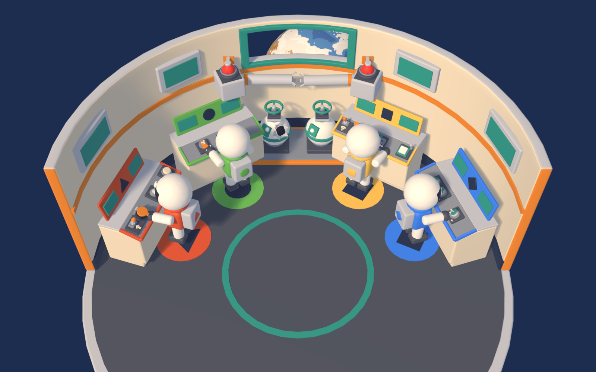
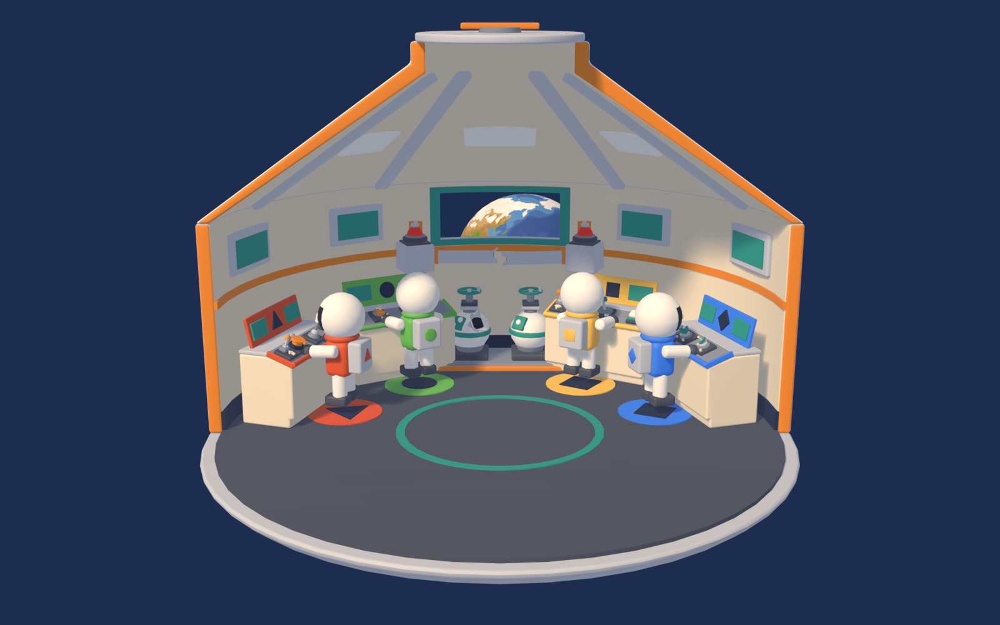

書いた人：iizuka（作成：Fable 5.2）／ 最終更新：2026-11-14

# 船室 `Ship_Interior` の設計と配置（#40）

宇宙船の内部。ゲームで4席のコンソールとクルーを置く部屋。コンソール・クルー・タンクなどは入っていない（置き場所の `.Slot_〜` だけ）。

- 作るスクリプト：`modeling/interior/build_interior.py`（数値は冒頭の定数）
- 組み立て図を撮るスクリプト：`modeling/interior/render_assembled.py`
- FBX：`unity/Assets/Models/Ship/Ship_Interior.fbx`／glb：`modeling/interior/export/Ship_Interior.glb`
- 機械が読む表：`layout.json`（Slot の座標・表示の切り替え・カメラ）、`parts.json`（可動部＝ハッチ）
- 三角数 9,048（上限 10,000）。`check.py modeling/interior` は全項目合格

| 見下ろし 50°（席に寄せる） | 横からの断面 15° |
|---|---|
|  |  |

## 1. 設計の判断

| # | 決めたこと | 理由 |
|---|---|---|
| 1 | **y=0 の面で前後に割ったドールハウス**。奥半分（`Wall_Back`・`Roof_Back`）は固定、手前半分（`Wall_Front`・`Roof_Front`）は消せる | カメラが未決定（#9）。カメラを正面（−Y）に置くかぎり、見下ろし角が 0°〜50° のどこでも、奥半分の壁と屋根は中の物を隠さない（円筒は外にふくらんでいるので、中を見る線は必ず手前半分を通る）。だから**断面と俯瞰の違いは「カメラの角度」と「奥の屋根を出すか」だけ** |
| 2 | 形は**円形の床（直径 6m）＋円筒の壁（高さ 2.15m）＋円錐の屋根＋てっぺんの筒とハッチ** | 床と壁は art-direction.md（円形の床、壁、窓1つ）。屋根を付けると、断面で見たときにスケッチ（円筒の上がとがった宇宙船を縦に切った絵）と司令船の「円錐」に見える。アポロ司令船そのまま（床から円錐）にしなかったのは、壁が内側に倒れると窓と壁の物が見下ろしのカメラからほとんど見えなくなるため |
| 3 | 席は**奥の壁に沿った扇形**：左から Pilot（θ=−72°）、Life Support（−32°）、〔酸素タンク〕、Comms & Power（+32°）、Mission Planner（+72°）。クルーは背中（席アイコン）をカメラに向ける | コンソールは「操作する側が −Y、後ろの板のアイコンがクルーの頭の上から見える」作りなので、カメラに向けて並べるのがいちばん読める。左右の2台はほぼ横向きになり、断面でも「コンソールに向かう人」が横から読める。4人の横位置は 0.7m 以上ずれていて、0° の真横から見ても重ならない |
| 4 | **酸素タンクは奥のまん中**（窓の下、オレンジの縁の台の上）。漏れる Tank 2 が左＝Life Support の隣。上に事故の前後で差し替えるパイプ、その両端の箱の上に警報ランプ2つ | 酸素漏れはこのゲームの中心の出来事なので、どちらのカメラでも正面に見える場所に置いた。実物ではタンクは機械船にあるが、Life Support がバルブを回すので船室の中に「点検用の台」として出した |
| 5 | **席が空いても分かる床の印**（席の色の円＋アイコン）。3人のときに使える「2台の間」の位置も1つ用意 | 標準は3人（#9）。空いた席はコンソールと床の印が残り、クルーだけいない。Comms & Power と Mission Planner を隣どうしにしたので、兼ねる人は2台の間に浮ける |

## 2. 形と寸法（m）

向き：Z が上、正面（カメラの側）は −Y。**原点は船底の中心（底が z=0）**。床の上面は **z=0.30**。
角度 θ：真上から見て奥（+Y）が 0°、右（+X）へ ＋。点は (r·sinθ, r·cosθ, z)。

| 部分 | 寸法 |
|---|---|
| 床 | 直径 6.0（壁の内側は半径 2.85）。上面 z=0.30。船底の厚み 0.26。床の目地（`FloorJoint1`〜`3`）は同心円、半径 1.45・2.05・2.55m、幅 2.5cm、高さ 5mm（床の上に載せる） |
| 壁 | 厚み 0.15、z=0.26〜2.45（床から 2.15） |
| 屋根 | 円錐：z=2.45（半径 3.0）〜4.00（半径 0.85）。筒：〜4.20。ハッチのふた：直径 1.6、取っ手の上が z=4.37 |
| 窓 | 奥のまん中、幅 約1.48（θ=±15°）× 高さ 0.58（床から 1.44〜2.02）。穴が開いている（ガラスなし） |
| コンソール | 原点の半径 2.30。操作する側が部屋の中心を向く。奥の角は半径 2.70（壁まで 0.15） |
| クルー | Slot（浮いている中心）の半径 1.75（コンソールの原点から 0.55 手前）。Slot は床から 0.12。モデルは Slot から局所 Y +0.16m・前後 +0.03m に置く（床から 0.28。腕が天板 0.80m に届く。art-direction.md と同じ） |
| タンクの台 | 奥のまん中、1.56×0.80、床から 0.07 |
| パイプ | 軸の高さ z=1.56（床から 1.26）、y=2.585、長さ 1.84（`Fx_BrokenPipe` と同じ） |

色：壁の内側 `cream`、外側 `white`、**切り口 `orange`**（断面だと分かるように）、床板 `cream`（船底は `gray_light`）、床の目地 `gray_light`（`FloorJoint1〜3`）、すその帯 `navy`、壁の帯 `orange`、窓枠と床の輪 `teal`、席の印は席の色＋`navy` のアイコン。

## 3. 部品と、カメラ別の表示

| 部品 | 中身 | 見下ろし | 断面 | 外から |
|---|---|---|---|---|
| `Floor` | 船底・床板・同心円の目地・中央の輪・席の印・タンクの台 | 出す | 出す | 出す |
| `Wall_Back` | 奥半分の壁（窓・帯・窓枠・配管の箱2つ・画面の枠4つ（画面 MonScreen0〜3 は別の部品）） | 出す | 出す | 出す |
| `Wall_Front` | 手前半分の壁（外側に飾りの側面ハッチ） | **消す** | **消す** | 出す |
| `Roof_Back` | 奥半分の屋根（骨4本）。子に `Move_Hatch`・`Lamp_Cabin` | **消す** | 出す | 出す |
| `Roof_Front` | 手前半分の屋根 | **消す** | **消す** | 出す |
| `Move_Hatch` | てっぺんのハッチ。X まわり −110°（開）〜0°（閉）。`parts.json` | （屋根と一緒に消える） | 出す | 出す |
| `Lamp_Cabin` | 室内灯（屋根の内側の白い板3枚）。色は `white`。Unity では暖色の白で常に光らせる（`LampGlow`。点滅しない） | （屋根と一緒に消える） | 出す | — |
| `Pipe_Intact` | 事故の前のパイプ | 事故のとき消して `.Slot_Pipe` に `Fx_BrokenPipe` | 同じ | — |

- 見下ろしで `Roof_Back` を消すのは、てっぺんの筒とハッチが奥の壁（窓）を隠すため（`renders/Ship_Interior_1_game.png` がその状態）。art-direction.md の「屋根なしの断面」と同じ。
- 「消す」は Unity で `SetActive(false)`。子も一緒に消える。手前の壁を外へ滑らせて消す演出にしてもよい。
- 同じ表が `layout.json` の `show` に入っている。

## 4. Slot の一覧と座標

Blender の座標（m、Z まわりの角度は度）と、Unity の座標（`Ship_Interior` を原点・回転0 に置いたとき。位置は (−x, z, −y)、Y まわりの角度は −Z まわり）。FBX に Empty として入っているので、**Unity では Slot の子にモデルを置けばよい**（位置0・回転0）。

| Slot | Blender の位置 | Z まわり | Unity の位置 | Y まわり | 置く物 |
|---|---|---|---|---|---|
| `Slot_Console_Pilot` | (−2.187, 0.711, 0.300) | 72 | (2.187, 0.300, −0.711) | −72 | `Console_Pilot` |
| `Slot_Console_LifeSupport` | (−1.219, 1.950, 0.300) | 32 | (1.219, 0.300, −1.950) | −32 | `Console_LifeSupport` |
| `Slot_Console_CommsPower` | (1.219, 1.950, 0.300) | −32 | (−1.219, 0.300, −1.950) | 32 | `Console_CommsPower` |
| `Slot_Console_MissionPlanner` | (2.187, 0.711, 0.300) | −72 | (−2.187, 0.300, −0.711) | 72 | `Console_MissionPlanner` |
| `Slot_Crew_Pilot` | (−1.664, 0.541, 0.420) | −108 | (1.664, 0.420, −0.541) | 108 | `Crew_Pilot`（コンソールを向く） |
| `Slot_Crew_LifeSupport` | (−0.927, 1.484, 0.420) | −148 | (0.927, 0.420, −1.484) | 148 | `Crew_LifeSupport` |
| `Slot_Crew_CommsPower` | (0.927, 1.484, 0.420) | 148 | (−0.927, 0.420, −1.484) | −148 | `Crew_CommsPower` |
| `Slot_Crew_MissionPlanner` | (1.664, 0.541, 0.420) | 108 | (−1.664, 0.420, −0.541) | −108 | `Crew_MissionPlanner` |
| `Slot_Crew_Dual_CommsPlanner` | (1.261, 0.985, 0.420) | 128 | (−1.261, 0.420, −0.985) | −128 | 3人のとき：2台を兼ねるクルー（任意） |
| `Slot_Tank_1` | (0.370, 2.380, 0.370) | 0 | (−0.370, 0.370, −2.380) | 0 | `Tank_Oxygen1`（右） |
| `Slot_Tank_2` | (−0.370, 2.380, 0.370) | 0 | (0.370, 0.370, −2.380) | 0 | `Tank_Oxygen2`（左。事故で `Tank_Oxygen2_Broken`） |
| `Slot_Pipe` | (0, 2.585, 1.445) | 0 | (0, 1.445, −2.585) | 0 | 事故で `Fx_BrokenPipe`（`Pipe_Intact` を消す） |
| `Slot_Alarm_1`・`_2` | (∓1.018, 2.458, 1.780) | 0 | (±1.018, 1.780, −2.458) | 0 | `Fx_Alarm`（1 が左。片方だけでもよい） |
| `Slot_Center` | (0, 0, 0.300) | 0 | (0, 0.300, 0) | 0 | 空き（床のまん中） |
| `Slot_Window` | (0, 3.000, 2.030) | 0 | (0, 2.030, −3.000) | 0 | 窓のまん中（壁の外側の面）。地球・月はこの先に |

- バルブ `Ctrl_Valve` は、タンクの `.Slot_Valve` に付ける（core の決定どおり）。操作部品はコンソールの `.Slot_1〜6`。
- クルーの Slot は床から 0.12 の「浮いている中心」。Unity でここを中心に上下に揺らす（揺れ幅は Unity 側で決める）。クルーのモデルは Slot から局所 Y +0.16m・前後 +0.03m に置く（床から 0.28m。腕が天板 0.80m に届く。7章）。
- ガスの噴き出し口は、置いたモデルの `Tank_Oxygen2_Broken.Slot_Leak`（部屋のまん中へ向く）と `Fx_BrokenPipe.Slot_Leak`。

### カメラ（提案。Slot として FBX に入っている）

縦の画角 30°、正面から。Empty の向きは「ローカル −Y＝見る向き、+Z＝上」なので、**Unity ではその Transform をそのままカメラに写せる**（forward が見る向き）。16:10 の画面に収まる距離で合わせた。もっと縦長の画面（4:3 など）では左右が切れるので引く。

| Slot | 何が入るか | Blender の位置 | Unity の位置 | Unity の回転 |
|---|---|---|---|---|
| `Slot_Cam_Topdown` | 見下ろし 50°、床の全体 | (0, −8.182, 10.594) | (0, 10.594, 8.182) | (50, 180, 0) |
| `Slot_Cam_Topdown_Close` | 見下ろし 50°、席に寄せる（床の手前は画面の下に切れる） | (0, −5.391, 8.561) | (0, 8.561, 5.391) | (50, 180, 0) |
| `Slot_Cam_Cutaway` | 横からの断面 15°、屋根まで | (0, −11.277, 4.576) | (0, 4.576, 11.277) | (15, 180, 0) |

## 5. カメラ別の見え方（組み立て図で確かめた）

`render_assembled.py` が、できているモデルの glb を Slot に置いて撮った。4人・事故のあと（左のタンクが破れ、パイプが折れ、警報ランプ2つ）。窓の向こうの地球は確認用に置いただけ。

| 画像 | カメラ | 見て分かったこと |
|---|---|---|
| `renders/interior_assembled_topdown.png` | 見下ろし 50°・全体 | 4席とも読める。クルーの背中のアイコン、コンソールの板、パネルの上の操作部品が見える。床の手前半分は空く |
| `renders/interior_assembled_topdown_close.png` | 見下ろし 50°・席に寄せる | 320px 版でも4席の色とクルーが見分けられる。タンクのバルブと破れた穴が見える |
| `renders/interior_assembled_cutaway.png` | 断面 15° | 左右の2人は横から、まん中の2人は斜め後ろから。4人とも重ならない。切り口のオレンジで断面と分かる。屋根で宇宙船の形に見える |
| `renders/interior_assembled_3p_topdown.png` | 見下ろし 50°・3人・事故の前 | Mission Planner の席が空き（青い印と◆が見える）、黄色のクルーが2台の間。パイプは折れていない |

断面の見下ろし角は 0°・15°・25° を撮って見比べた（`render_assembled.py -- --elev <度>`）。0° でも4人は重ならず使えるが、まん中の2人が自分のコンソールの中央を隠す。**15° 前後**だと板のアイコンが頭の横から見え、床の奥行きも分かる。

## 6. 人数と席

| 人数 | 見せ方（提案） |
|---|---|
| 4人 | 1人1席。`Slot_Crew_<席>` |
| 3人（標準） | Comms & Power が Mission Planner を兼ねる。黄色のクルーを `Slot_Crew_Dual_CommsPlanner`（2台の間）に置くか、操作する席の Slot へ移す。Mission Planner のコンソールは残す（操作部品が要る） |
| 2人・1人 | クルーを、操作している席の Slot へ移す。空いた席は床の印が見える |

## 7. Unity で置く手順

1. `Ship_Interior.fbx` をシーンに置く。ルートは Y まわり 180° に回す（今の Unity の置き方。4章の座標はルートからの相対値なので、回しても変わらない）。位置は 0 のまま（床の上面が y=0.30）。床を y=0 にしたいときは y=−0.30 に置く。
2. 各 Slot の子に、対応するモデルを位置0・回転0 で置く（表のとおり）。ただしクルーは例外で、Slot の子に置いて局所 Y +0.16m・前後 +0.03m ずらす（床から 0.28m）。
3. カメラに合わせて部品を消す（3章）。カメラは `Slot_Cam_〜` の Transform を写し、FOV 30。
4. 事故のとき：`Pipe_Intact` を消して `Slot_Pipe` に `Fx_BrokenPipe`、`Slot_Tank_2` のタンクを破れ版に差し替え、`Fx_Alarm` を光らせて回す。警報の赤い Point Light（強さ 2.0、範囲 3.5m）を `Slot_Alarm_1`・`_2` の両方に付けて、一緒に点滅させる（art-direction.md）。
5. 屋根を出すと、屋根の内側は平行光が当たらず暗い（Blender のレンダーでも灰色）。そこで `Lamp_Cabin` を暖色の白で常に光らせ（`LampGlow`。点滅しない）、`Slot_Center` の 2.2m 上に室内灯（Point Light、`#FFE2B8`、強さ 1.5、範囲 5m、影なし）を置く（art-direction.md）。

## 8. 決めてほしいこと

- [ ] **カメラ**（#9）：見下ろし 50°、断面 15°、場面で切り替え、のどれか。モデルはどれでも使える。見下ろしは「全体」と「席に寄せる」のどちらを基本にするか
- [ ] **席の並び**：左から Pilot／Life Support／〔タンク〕／Comms & Power／Mission Planner でよいか。SPEC の2人の案（Pilot＋Mission Planner）は両端になる
- [ ] **タンクを船室に置く**ことでよいか（外観の `Ship_SM` では、外板の中にタンクがある。実物は機械船）。事故の見た目は「破れたタンク」と「折れたパイプ」の両方を出すか、片方か
- [ ] **3人のとき**：クルーを2台の間に置く（`Slot_Crew_Dual_CommsPlanner`）か、席の間を移動させるか。空いた席のコンソールを暗くするか
- [ ] **床の手前半分**が空いている。UI の置き場にするか、まん中（`Slot_Center`）に CO2 フィルターなどを置くか
- [ ] **外から見た姿**に使うか。閉じた姿（`renders/Ship_Interior_4_closed.png`）は直径 6m の簡単なカプセルで、外観の `Ship_CM`（直径 3.9m）とは形も大きさも違う。同じ画面に並べない前提
- [ ] 壁の画面4つ（青緑の無地）と窓に、Unity で何を映すか

## 9. 気づいた食い違い

| # | 食い違い | この船室での扱い |
|---|---|---|
| 1 | `modeling-plan.md` 0章 6 は「船室は今回は作らない」。#40 で作った | 計画の文書は直していない（並行作業とぶつからないように）。親に報告 |
| 2 | art-direction.md は「原点は床の中心」、core のルールと `check.py` は「底面が z=0」 | core に合わせた。原点は船底の中心、床は z=0.30。Slot が高さを持っているので置くときは困らない |
| 3 | `check.py` の三角数の上限は `Ship_` が 6,000、art-direction.md は「船室 10,000 以下」 | `check.py` に船室（名前に `Interior`）の上限 10,000 を足した |
| 4 | core は「FBX → `unity/Assets/Models/<種類>/`」。船室は FBX が `Ship/`、元データが `modeling/interior/` | `export.py` の `KINDS` に `"interior": "Ship"` を足し、`check.py` が同じ `Ship/` の中で外観と船室を見分けるようにした（core README 9章） |
| 5 | スケッチは横からの断面でクルー3人（2人）、art-direction.md は見下ろしで4席 | どちらにも使える形にした（1章） |
| 6 | コンソールは「クルーの背中をカメラに向ける」前提の作り。真横（0°）の断面では、まん中の2人が自分のコンソールを隠す | 断面のカメラは 15° を提案 |
| 7 | 酸素タンクは、外観（`Ship_SM`）では機械船の中、船室ではこの部屋の中 | ゲームの都合で船室に置いた。決めてほしいことに入れた |
| 8 | SPEC の酸素漏れは Tank 2（タンクが破れる）。`Fx_BrokenPipe`（折れたパイプ）は SPEC に出てこない | 両方の置き場所を用意した |
| 9 | core の「ランプ色は `.Lamp_` の部品だけ」。`Lamp_Cabin` は `.Lamp_` だが色は `white` | ルールには反しない（逆向きの決まりはない）。`LampGlow` は `Lamp_Cabin` を点滅させず、暖色の白で常に光らせる（art-direction.md）。ほかの `.Lamp_` は点滅させる |
| 10 | 見下ろしのカメラで窓から地球を見せるには、地球を船の「奥の下」に置くことになる（カメラが下を向いているため） | 組み立て図ではカメラごとに置き直した。ゲームでの置き方は Unity 側で決める |
