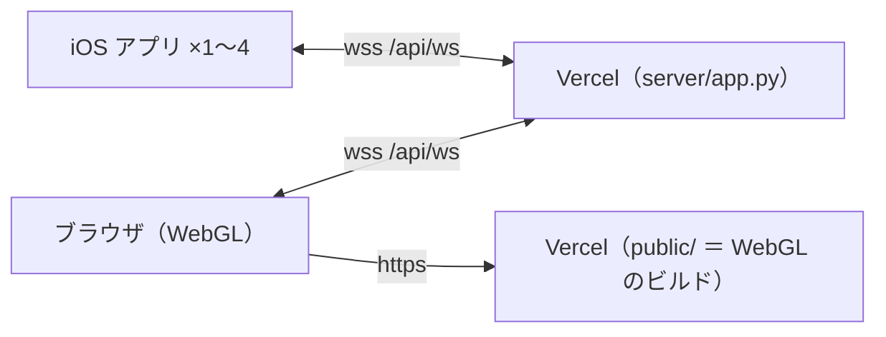

書いた人：Taiga（Claude） ／ 最終更新：2026-11-15（#222）

# Vercel に置く（ゲームのサーバーとブラウザ版）

1つの Vercel プロジェクトに、Python のサーバー（`/api/ws`）と、ブラウザ版（WebGL のビルド。あれば）を置く。iOS のアプリも同じ `/api/ws` につなぐ。



## 手順

1. （ブラウザ版も置くなら）Unity のメニュー `Tools/Build/WebGL (Vercel)` → `unity/Builds/WebGL/`
2. 置くフォルダを作る（`tmp/vercel/`。コミットされない）

   ```sh
   python tools/vercel/make_bundle.py --webgl   # サーバーだけなら --webgl なし
   ```

3. 置く（初回は `npx vercel login`。プロジェクト名を聞かれる）

   ```sh
   npx vercel deploy tmp/vercel --prod
   ```

4. 確かめる

   ```sh
   curl https://<vercel の URL>/api/health
   cd server && uv run python tools/bot_client.py --url wss://<vercel の URL>/api/ws --bots 4 --case T1
   ```

5. つなぐ先を Unity に教える
   - ブラウザ版：何もしない（開いたページと同じホストの `/api/ws` につなぐ）
   - iOS・デスクトップのビルド：`unity/Assets/Resources/server_url.txt` に `wss://<vercel の URL>/api/ws` を1行書く
   - エディタ：Title の Developer の Server URL（既定は `ws://localhost:8765`）
   - 決めているのは `unity/Assets/Scripts/Net/WebLink.cs`。ページの `?server=…` があればそれが先

## 手元で同じ入口を試す

```sh
cd server && uv run uvicorn app:app --port 8766
uv run python tools/bot_client.py --url ws://localhost:8766/api/ws --bots 4
```

`MISSION_RETURN_SPEED=4` を付けると4倍速。

## 気をつけること（Vercel の決まり）

出典：<https://vercel.com/docs/functions/websockets>

- **部屋は Redis に置く**。Vercel は接続ごとに別のインスタンスへ届ける（実測：メモリの部屋だと、ボット4人のうち1人が `no_such_room` になった）。Vercel のプロジェクトに Redis（Storage → Upstash for Redis）をつなぐと環境変数 `REDIS_URL`（か `KV_URL`）が入り、`server/app.py` が `game/redis_server.py` を使う。`/api/health` の `store` が `redis`、`redis` が `true` ならよい
- **接続は 270 秒でサーバーから閉じる**（Vercel が関数の最大時間で黙って切る前に）。クライアントが自動で同じ部屋・同じ席に戻る（#94）。そのとき画面に RECONNECTING が出ることがある。秒数は環境変数 `MISSION_RETURN_MAX_CONN_S`
- **予備**：同じサーバーを `server/main.py` で動かして Cloudflare Tunnel で出す（`server/README.md`）。`?server=xxxx.trycloudflare.com` か Developer の Server URL でそちらにつなぐ

## iOS（Apple Developer Program）

- この PC（Windows）ではビルドできない。Mac と Xcode、Unity の iOS Build Support が要る
- つなぐ先は上の `server_url.txt`
